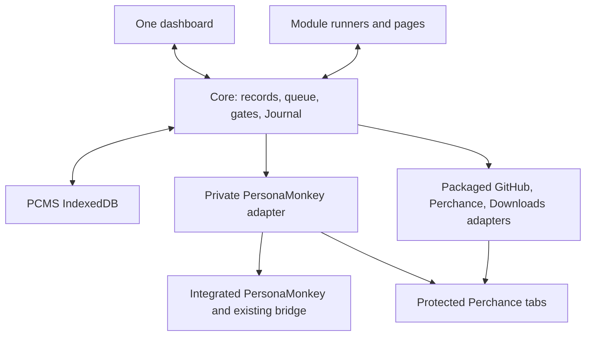

# PCMS architecture design

31 October 2026 · Design revision 2 · Perchance Management System

This document defines one implementation. It does not authorize implementation or report product acceptance. It resolves engineering choices left open by the accepted specification. The supplied architecture package and accepted specification remain unchanged. Revision 2 incorporates the targeted independent design review; it does not claim implementation or additional live evidence.

## 1. Authority and evidence

The authority order is: accepted `spec/PCMS-Working-Draft-v42.md` §§1–7; the latest explicit decisions in `PROMPT.md`; verified evidence; the engineering choices in this document. The handoff's requests for another DEVELOP probe and for phase files are superseded by `PROMPT.md`. Older specifications, Alpha governance, and Discovery's proposed APIs are not requirements.

References below are relative to the supplied architecture package unless a URL is given. These references identify evidence; they are not runtime dependencies.

| ID | Evidence and limit |
|---|---|
| V42 | `spec/PCMS-Working-Draft-v42.md`. Accepted product authority. |
| P | `PROMPT.md` and `decisions/PCMS-DESIGN-HANDOFF-2026-10-31.md`, with the precedence above. Latest scope decisions. |
| A | `research/PCMS-ARCHITECTURE-AUDIT-v2.md`, especially §3 and Appendix A. SOURCE, historical incident evidence, and older synthetic/browser findings. Its earlier open questions are superseded where P supplies a decision or later evidence. |
| Q | `research/PCMS-ASSUMPTION-REVIEW.md`, F01–F24. Corrected assumptions and failure checks. |
| F | `research/PCMS-FEASIBILITY-RESULTS.md` §§3–5; original receipts in `research/PCMS-FEASIBILITY-EVIDENCE.zip`. INSTALLED FIREFOX: Developer Edition 154.0b10, normal security configuration, module UI/background lifecycle, replacement, disable, event-page termination and real browser restart. SYNTHETIC and independent disk reopen: complete declared fixture archive, corruption rejection, fresh-profile container remap and interrupted restore. This is not a production PCMS PASS. |
| D | `research/discovery-v3.zip`: `discovery/DISCOVERY.md`, `FINAL_DELTA.md`, and referenced source captures. HISTORICAL: actual editor/source-save/new-chat/send mechanisms. `window.perchanceAutomation` and the MCP service are proposals, not installed APIs. |
| L | `evidence/develop/PCMS-DEVELOP-Live-Test-Assessment.md` and both original JSON reports. LIVE, user-run observations: three `src/` writes, save/reload/exact readback; corrected run has `exactInputReadback:true` and `exactPrompt:true` at native Send click. The four fixture files have identical 14-byte contents. Neither report proves substantive AI success, PCMS publication, or browser-restart continuity. Run `local-mvvnba4i` begins with `LOG_RESET`; it is a separate run. |
| U | USER-REPORTED: PersonaMonkey and its existing Mullvad bridge work reliably; ordinary Perchance sessions persist across browser restarts unless browser data is cleared. Preserve this baseline. Do not claim it is a new independently observed receipt. |

Targeted source reads for this design used Alpha commit `c5b23b77f50db7ffe50e2ef705a8bf0b5879e36e` and donor commit `9995f6eadfa54be6cc0001f4e04f2a2d9b9401bf`. They confirmed `src/runtime/entry.mjs`, `route-pin.mjs`, `perchance-supply.mjs`, `git-writeback.mjs`, and donor `extension/lib/recovery-bootstrap.js` and `persona-cookies.js`. No new repository inventory, audit, CI run, feasibility test, or provider mutation was performed. The package manifest hashes were checked, and the separate attached prompt equals `PROMPT.md`.

## 2. Runtime, boundaries, and startup

### 2.1 One host

Use one Firefox MV3 extension with a packaged, nonpersistent background page. A document-based event page owns module sandbox frames. Use Firefox's event-page lifecycle, not a Chrome service-worker model. One dashboard tab is the only management interface. The toolbar action focuses or opens that tab; there is no action popup or legacy dashboard.



| Component | Owns | Does not own |
|---|---|---|
| PersonaMonkey | Personas, containers, route selection/repair, protected tabs, fail-closed network policy, existing native protocol | PCMS jobs, Git readiness, publication decisions |
| Private donor adapter | Translate PCMS account IDs to donor services; check exact binding; expose readiness and portable donor data | Proxy implementation, independent routes, generic native RPC |
| Core | Durable records, transactions, fair queue, effect fences, source exclusivity, module lifecycle, redacted recording, shared queries | Enrollment, creation, deployment, refresh algorithms, general workflow graphs |
| Module | Its finite workflow steps, interpretation of typed observations, settings and page | A database, queue, route controller, raw privileged API, or Git token |
| Module host | ZIP validation, sandbox lifecycle, generation binding, page registrations and teardown | Arbitrary background keepalive guarantees or hostile-code CPU isolation |
| Perchance adapter | Fixed, target-bound observations and effects in donor-protected contexts | AI engine, provider-independent HTTP automation, all-site storage backup |
| GitHub adapter | Configured repository, `main`, immutable reads and conditional scoped commits | Git task semantics or editing unrelated paths |
| Downloads adapter | Validated exports, durable file receipts and tracked deletion | General filesystem access or deleting files by glob |
| Dashboard shell | Queries, navigation, contextual actions, accessibility and view state | Work execution or a second controller |

The PCMS IndexedDB is the only PCMS record store and queue. PersonaMonkey keeps its proven internal persistence behind its adapter. Do not copy that persistence into a second mutable route model. Account records hold logical references and observations, not another route authority.

### 2.2 Firefox and installation

Select the manifest sandbox runtime demonstrated in F. Set the host's `strict_min_version` to **154.0**. The API floor is Firefox 154; the installed evidence is Developer Edition 154.0b10 only. The user's 153.5.0esr must be updated to an ESR base with these APIs, or a suitable Developer Edition. There is no 153 fallback. The selected initial installation channel is a persistently installed, locally built XPI on Firefox Developer Edition with a version that **satisfies** `strict_min_version: 154.0` (for example, a later Developer Edition release); an ESR release is eligible only if its actual base version meets the same minimum. The proof used Developer Edition `154.0b10`, which established the API but may compare **below** the final `154.0` minimum for installation; do not claim that the proof build itself satisfies the packaged minimum. This does not require a frozen browser version; the user regularly updates Firefox. Keep normal OS sandbox and extension CSP settings. Signature configuration for an unsigned development XPI is separate from sandbox configuration. [F; M1–M3]

Module installation is an explicit local ZIP selection. There is no executable download, remote update URL, or marketplace. Background/UI code runs only inside the declared opaque-origin sandbox. Privileged extension pages execute packaged code only. Website userscripts run through the donor's Firefox userscript mechanism. [F]

**Distribution limit:** Mozilla's current policy requires self-contained add-ons and restricts `userScripts` to website scripts, rather than augmentation of the manager. The evidence does not establish policy acceptance of independently selected background/UI ZIP code. Local selection or unsigned installation is not an exemption. This design selects the demonstrated technical development model; it makes no signed/public distribution claim. This remains a release limitation, not an additional ZIP approval procedure or a reason to redo the host proof. [M2–M3]

### 2.3 Extension identity and donor integration

**Keep the proven donor/Alpha Gecko ID `persona-route-manager@local`** for the initial combined PCMS build, installed into a **dedicated clean Firefox profile**. This preserves the working native-host allowlist and avoids changing the bridge merely to rename the extension. Do not install the new build over Alpha/PersonaMonkey in an existing profile: the same ID denotes the same extension within that profile and would replace that profile's installed package. The installer/test guide must explicitly check profile identity and existing add-ons before installation. Keep existing Alpha profiles and their data intact; do not import Alpha jobs implicitly. Alpha migration is outside this design.

**Alternatives considered:** a new ID (`pcms@personamonkey.local`) would isolate extension identity even in the same profile, but requires editing/revalidating the native-host allowlist; the existing ID in a clean profile avoids that host change. Separate Firefox profiles do **not** isolate the shared native Mullvad daemon. Do not run two active profile installations that issue competing donor route mutations against the same host without an operational compatibility check. Keep the native protocol, daemon, WireGuard implementation and installed allowlist unchanged. If the existing configured bridge fails to recognize the known ID, hold protected work and report an installation fault; never use Direct fallback. This is the least-change initial installation decision, not proof that arbitrary concurrent profiles are isolated. [A §2; F §4]

Retain the pinned donor and MIT attribution. Reuse the proven Alpha integration repairs. Keep build transformations explicit and small. The adapter exposes only `preparePersona`, `checkBinding`, `openProtectedTab`, `repairRoute`, `archivePersona`, `removeLocalPersona`, `readPortableState`, and `restorePortableState`. These are private PCMS interfaces over existing donor services, not claims that identically named donor APIs already exist.

Keep required donor permissions and privacy controls intact. The packaged host declares its storage/alarms/Downloads/GitHub and page-adapter permissions up front; ZIPs cannot expand them. Ship the initial compatible set of **Accounts, Discover, Creator, Deployer, Refresher, Journal and Backup** modules with the combined XPI, enabled by default. The operator installs no separate ZIPs to get a working initial PCMS. On first initialization, Core validates and atomically seeds their versioned module package records **as ordinary installed, enabled modules** before admitting their jobs. Persist an initialized marker with the registry transaction; a crash retries the same no-duplicate seed. On subsequent extension starts/updates, never overwrite an installed ZIP update, user-disabled state, module settings or unfinished jobs with the bundled copy. Restore uses archived packages and their saved enabled state rather than reseeding defaults; missing/incompatible packaged components stay held with an exact error. Settings → Modules retains independent ZIP updates and enable/disable for each module. Recreate the selected userscript world's configuration at startup/update. If Firefox's required userscript permission is not granted, show the actual browser permission action at Settings → Modules and hold affected scripts. A browser permission requirement is not a separate PCMS ZIP approval ceremony. No package can obtain raw `browser.*`, arbitrary native RPC, or unrestricted authenticated fetch through Core.

### 2.4 Boot order

1. Statically import the donor fail-closed routing gate/recovery bootstrap before any asynchronous PCMS work. Guards start blocked. Register Core wake/message/download listeners synchronously.
2. Open the active database generation. Load Pause, maintenance state, module registry, and account bindings. Start Core recording. If storage fails, admit no writes.
3. Let donor recovery finish. Rebuild account bindings from donor observations. Any volatile permission, route pin, tab handle, or lease starts invalid. A restored account tab remains blocked until the donor can safely protect it.
4. On first installation, complete the initial first-party module seed (§2.3) before registration. Otherwise restore the exact installed packages, including user updates and disabled states, rather than overwriting them with shipped defaults. Restore module sandboxes/world configurations and enabled userscript registrations; rebuild only enabled module alarms and mandatory Core upkeep from durable deadlines on every cold background evaluation, startup and installation.
5. Reconcile possible effects first. Reattach known documents only after checking account, Persona, remote generator and chat. Do not trust old tab IDs. Restore held/disabled jobs visibly.
6. Admit safe work if the persisted global state is Running. Resume no uncertain effect by replay. Opening the dashboard is not required for any step.

## 3. Local module ZIP contract

### 3.1 Package and ABI

A module is one ZIP containing `module.json` and the listed files. An example package is:

```text
module.json
background.js
page.js
ui.html
ui.js
ui.css
```

Example manifest below uses a descriptive hash placeholder; a real package supplies 64 lowercase hexadecimal digits for every file.

```json
{
  "format": 1,
  "id": "pcms-discover",
  "name": "Discover",
  "version": "1.0.0",
  "coreApi": 1,
  "jobSchema": 1,
  "readsJobSchemas": [1],
  "capabilities": ["records.discover", "jobs.discover", "perchance.classify", "github.prepareFolder"],
  "entries": {"background": "background.js", "userscript": "page.js"},
  "userscript": {"matches": ["https://perchance.org/*"], "lifecycle": 1},
  "pages": [{"id": "main", "title": "Discover", "html": "ui.html", "script": "ui.js", "style": "ui.css"}],
  "settingsSchema": 1,
  "files": [{"path": "background.js", "bytes": 1000, "sha256": "<64-hex>"}]
}
```

The abbreviated `files` array must list **every** payload file in a real package. The manifest does not list/hash itself. Core hashes its exact bytes and the whole original ZIP separately. ZIP hashes detect corruption, not authorship. No signing or cryptographic approval ceremony is added.

`format` and `coreApi` are exact supported major integers. `version` is a strict release `major.minor.patch`. An installed ID can update to a higher version with the same supported Core API. Same ID/version with different bytes is rejected. Identical bytes are a no-op. An explicit rollback can select a retained package if it can read current settings/jobs. There is no silent downgrade. `readsJobSchemas` lists exact job schemas understood by this code; `jobSchema` is its output schema. Core never edits opaque module checkpoints to make them appear compatible.

Reject duplicate JSON keys, unknown manifest fields, missing files, unsafe/absolute paths, backslashes, traversal, NUL, symlinks, case-folded path collisions, encrypted ZIP entries, nested package execution, and undeclared executable dependencies. Use UTF-8 paths, normal regular files, declared sizes, safe integer arithmetic, CRC and SHA-256 checks. Inflate incrementally against a visible import resource budget and available storage. Handle quota failure without changing the active module. This is an import safety budget, not an account/generator/source product limit. No arbitrary remote host, raw fetch/native capability, or new extension permission can be added by a ZIP.

### 3.2 Three roles, one module

**Background:** A finite step handler runs in a packaged sandbox frame owned by the event page. It receives a job snapshot and limited RPC. It returns a checkpoint, wait, completion or typed hold. It has no durable in-memory stack. Core can destroy/rebuild it after suspension. Suspend on an external wait; persist its next due time instead of keeping a sandbox loop alive.

The packaged runner supplies `PCMS.defineModule({start, runStep, reconcile, stop})`. A package calls it once. `start` validates its saved settings/checkpoint without effects. `runStep(job, api)` returns `{kind:"checkpoint"|"wait"|"hold"|"complete", checkpoint, dueAt?, reason?, recovery?}`. `reconcile` is read-only until Core records a resolved effect and admits a later normal step. `stop` disposes only module-owned resources. Core persists the returned checkpoint with an expected job revision. UI calls `PCMS.query`, `PCMS.action` and `PCMS.saveView` through the bound runner; page lifecycle replies contain instance/document/generation, disposed-resource count and unresolved-effect IDs. These are version-1 host interfaces to implement, not existing provider functions.

**UI:** The shell loads sanitized package HTML/CSS and supplied script in its sandbox runner. It uses the same Core action/query API as the module background. Core owns the frame binding and navigation. UI closure never owns a job. Persist form drafts before acknowledging their save, and restore them after package updates. UI code cannot navigate the top-level shell or load remote assets/code.

**Userscript:** Reuse donor URL/Persona/world selection and Firefox registration. Every page instance registers a lifecycle handle, observers, listeners, timers and injected nodes with a common disposer. It may observe, present UI and request a fixed Core operation. It must not perform autonomous account/source/Git mutations. A packaged page adapter performs approved provider effects. Do not ship the diagnostic probe unchanged; its page-local log limit and manual Send behavior are test-specific.

Use the **Firefox 154+ manifest sandbox** for supplied module background/UI code. Minimal **illustrative** MV3 manifest fragment (check against the tested runner when packaging):

```json
{
  "sandbox": {"pages": ["sandbox/module-runner.html"]},
  "content_security_policy": {
    "extension_pages": "script-src 'self'; object-src 'none'",
    "sandbox": "sandbox allow-scripts; default-src 'none'; script-src 'self' 'unsafe-eval'; style-src 'self' 'unsafe-inline'; img-src 'self' data: blob:; connect-src 'none'; worker-src 'none'; frame-src 'none'; object-src 'none'; form-action 'none'; base-uri 'none'"
  }
}
```

`unsafe-eval` is confined to the **sandbox** CSP, not `extension_pages`; sandboxing never includes `allow-same-origin`. Only packaged runner scripts and declared local non-executable media/styles are loaded; `data:`/`blob:` are for declared UI images, **not script execution**. No remote code, network, workers, forms or child frames are permitted. An iframe hosting a module's UI must communicate with packaged Core through checked messages rather than extension APIs. The host checks the exact frame `contentWindow` and host-issued channel binding; `origin:"null"` is not identity. This example fixes the necessary manifest directives, not a new installed-test PASS. Keep any actual proven runner allowances that are required by its tested HTML/CSS and validate the final CSP in the built-XPI integration tests. [F; M1; MDN sandbox/content_security_policy]

Module RPC carries a request ID, job ID and expected record revision. Module ID, package hash, generation, boot ID and granted scope come from the host-held binding, never from trusted client fields. Page callers are also checked against runtime sender tab/frame/document, registered world and donor-selected container. Reject old documents, stale generations, disabled modules, wrong targets and undeclared operations. Public DOM messages are observations only; they cannot grant authority. All final effect gates are packaged Core checks.

### 3.3 Install, update, disable and recover

1. Validate and store the candidate package without activating it. Check settings and unfinished-job compatibility in a side-effect-free start check.
2. Stop new admission for that module. Let a dispatched finite effect reach readback or a durable Unknown hold. Other modules continue. A module update must not cancel an HTTP request and declare it absent.
3. Advance the module fence. Unregister future injection. Send `STOP(generation)` to every existing page instance. Its disposer cancels its own timers/observers, removes its UI/hooks, releases only local handles and returns a stop receipt. Do not erase editor text, chat, undo history or drafts.
4. Reject all old-generation Core requests immediately. Activate no new page writer until old page instances have acknowledged safe stop. If a noncooperative instance needs reload, reload only after proving the editor clean and the job safe. A dirty editor, active/unknown AI run or uncertain provider effect holds the update and retains a **Continue review** or **Open affected editor** action. Never reload away unsaved work.
5. Remove old runner/UI frames. Atomically switch active package, settings-schema pointer and generation. Rebuild registrations/world settings and UI. Resume compatible jobs after reconciliation. Retain incompatible jobs with their input, package provenance and a useful compatibility error.

On a crash during update, the durable lifecycle record identifies staged package, active pointer and page-stop receipts. Startup continues teardown/reconciliation. Never run both generations. Before activation failure, keep the previous package pointer. After activation failure, hold the module; roll back only if the retained package can read the now-current records. No reverse migration is assumed.

Disable uses the same fence and stop protocol. No new module work is admitted; settings, files and jobs remain. If an old page cannot stop, show **Disabling — editor needs attention**, with effects revoked. Enable reconstructs the same saved jobs. **Module Disable is not global Pause.** Disabling **Backup** prevents new automatic Backup captures/exports and manual Backup module operations. Disabling **Journal** prevents new Journal-module search/export work and automatic Journal exports, while **mandatory Core event recording continues** in the same IndexedDB. Already-dispatched exports finish or reconcile safely; no duplicate or abandoned file is silently created. Preserve records, packages, settings and export schedules for later Enable, but do not schedule disabled-module work. Settings must identify the disabled protection/export and show that its last successful export may become stale. Enabling rechecks deadlines and performs at most one due operation; it never bursts missed exports. **Global Pause** still allows enabled Journal exports, enabled Backup captures/exports, Core recording, donor protection and read-only status. Closing a module's UI without disabling the module does not stop its background automation.

Page teardown in a dirty editor is a **future installed-host test**, not an already passed result. Trust selected compatible packages to honor finite execution and lifecycle rules. Sandbox isolation is not a guarantee against a malicious CPU loop. [F §3]

## 4. Shared records, API and queue

### 4.1 Database

Use one IndexedDB database with an `activeDataset` pointer and these logical stores. Every mutable row has `schema`, `rev`, `createdAt`, `updatedAt`; Core increments `rev` in the same transaction as its event. Stable IDs are UUIDs, independent of slugs, tabs and Firefox container IDs.

| Store | Main fields and indexes |
|---|---|
| `meta` | Dataset/schema version, global Pause/admission epoch, maintenance/capture/restore records, Journal sequence, browser schedule deadlines and repository configuration. No token in projections. |
| `accounts` | `accountId`, enrollment/archive state, expected provider principal, `personaUid`, donor route reference, observed exit, observation times, holds. Unique active Persona/principal/known-exit indexes. |
| `generators` | `generatorId`, slug, optional remote stable ID, account, repository/folder, creation reservation, listing/ownership observations, source manifest references, deployment version, persistent writer hold, Refresher cycle. Unique repository/folder and managed slug; index account/listing/work/cycle. Folder-only records have no remote identity yet. |
| `jobs` | `jobId`, unique `logicalKey`, module/job schema, target/account, immutable input references, checkpoint, state, due time, acceptance and effect history, recovery action. Index module/state/due, target, account and update sequence. |
| `modules` | Exact ZIP/payload blob references, active/staged package hash, generation, enabled/lifecycle state, settings and saved UI drafts. Settings/checkpoint fields are namespaced to the owning module. |
| `blobs` | Content-addressed SHA-256, length, MIME hint, binary chunks and reference metadata. Includes package files, source, instructions and PCMS-held history. |
| `events` | Monotonic sequence, time, operation/job/target/module IDs, step, result, evidence references and sanitized error. Index time, target, job, module, severity; token index for search terms. |
| `credentials` | GitHub token and extension-owned secrets. Packaged adapters/backup codec only. Modules and normal UI receive status, never secret values. |
| `files` | Export/capture ID, type, sequence range/dataset revision, automatic/manual flag, exact filename/download ID, size/hash, completion and cleanup state, originating profile. |

Module workflow checkpoints are JSON-compatible data. Binary data uses blob references. Large source and package bytes are stored as chunks, never copied into every job/event. A source manifest is a sorted list of `{path, bytes, sha256, blobId}`; its hash includes each path, length and digest. Compare complete file sets, including deletions and binary `src/` files. Keep previous-good source and every PCMS-retained history reference. Garbage collection deletes only unreferenced blobs after snapshots release their pins. No Alpha file-count/byte limits become product limits. Storage exhaustion stops affected writes and reports the actual resource failure.

Credentials are isolated by the packaged access boundary within the extension origin, not an invented secure vault. The unencrypted archive includes them. Exception objects, arbitrary response bodies and provider URLs with query/hash capabilities must never enter an event directly.

Example job:

```json
{
  "schema": 1,
  "jobId": "<uuid>",
  "logicalKey": "deploy:<repo-id>:<generator-id>:v1",
  "moduleId": "pcms-deployer",
  "jobSchema": 1,
  "targetId": "<generator-id>",
  "accountId": "<account-id>",
  "input": {"version": "v1", "action": "DEVELOP", "commit": "<git-sha>", "inputHash": "<sha256>"},
  "state": "HELD",
  "step": "SEND",
  "effect": {"operationId": "<uuid>", "boundary": "POSSIBLE", "candidateHash": "<sha256>"},
  "recovery": {"action": "CHECK_AI_HELPER", "reason": "SEND_OUTCOME_UNKNOWN"},
  "rev": 12
}
```

### 4.2 Narrow common API

| API group | Contract |
|---|---|
| `query.list/get/search` | Secret-safe indexed projections, stable cursor paging, cross-account/generator/job/folder search. No fixed last-page ceiling. |
| `jobs.enqueue/checkpoint/wait/hold/complete` | Typed module-owned jobs, unique logical key, expected-revision changes and validated target ownership. Core records every transition. |
| `jobs.requestModule` | Typed dependency request using the same queue, e.g. `creator.ensureGenerator`. One reply/reference to its job; no nested queue. |
| `persona.prepare/check/open/repair` | Existing donor authority through the private adapter. Callers supply account and purpose, never route internals or arbitrary URLs. |
| `perchance.observe/effect` | Named operations only: identity, classify, source, editor, AI status; create, rename, unlist, source-save, new-chat, send, publish. Scope and required receipts depend on the operation. |
| `github.observe/readInputs/prepareFolder/writeSource/markDone` | Configured repository ID and `main`; exact path/version/input preconditions. No caller-supplied destination host or arbitrary ref write. |
| `journal.record/query` | Structured event schema; Core attaches caller identity and rejects/redacts secret-bearing fields. |
| `backup.capture/restore`, `exports.write` | Packaged system-maintenance capabilities. Modules may request the service, not obtain raw credentials through a generic query. |
| `ui.openTarget/saveView/action` | Shell-owned navigation/actions; module page descriptors come from its active validated manifest. |

Return `{ok, code, revision, observationRef, recoveryAction}`. Unknown is a result, not a retry instruction. Every command has a stable request ID, so double clicks return the existing result/job.

### 4.3 Fair work and exclusivity

Core dispatches one finite step per turn. Use round-robin across ready modules, then accounts, then oldest eligible jobs. Resume an existing effect's readback ahead of starting another effect for that target. A Discover batch is many queue items, not a loop that monopolizes the runner. Export/Journal deadlines receive reserved maintenance turns. Rate-limited providers wait on `dueAt`, without blocking other accounts or services.

Initial resource budgets: two simultaneous automated Perchance operations globally; one per account; one Discover checking tab; one rendered-directory observer; at most two **actively automated DEVELOP operations**. These are adjustable, measured concurrency settings, not product capacities. Tabs **parked for human review do not occupy active DEVELOP operation slots**; preserve every parked job's actual protected editor tab rather than recycling it. Bound total live tabs by observed browser memory/resources, with transparent queueing when the real tab budget is reached; do not silently close a review tab, impose a permanent two-review limit or open 1,000 editors. A queued third active DEVELOP job waits only when active-work or actual browser resource limits require it. User-open tabs are not forcibly closed. Inspect all managed editor documents before taking a source write.

Logical keys: enrollment uses its command ID; Discover uses batch/normalized slug; Creator uses repository/folder identity; deployment uses repository/generator/version; Refresh uses generator/cycle/decision ID. Automatic reconciliation reuses the job and operation ID. A unique key prevents duplicate intake even when Git observations or UI requests repeat.

Acquire a generator writer claim transactionally when a job is ready for a source write. A dependency-only `WAIT_CREATOR` job has no Deployer source claim; its Creator job retains independent create/rename fences until identity is verified. The persistent source claim names the job and reason; the runtime lease includes a fresh `bootId` and module generation. During AI/review/manual conflict, release the scarce execution slot but retain the persistent generator hold. All source modules honor it. After restart/restore, runtime leases are invalid; possible effects and persistent holds remain and must be reconciled before granting another writer. No TTL expiry authorizes replay or clears an uncertain writer.

### 4.4 Effect boundaries and Pause

| Boundary | Durable meaning | Next permissible action |
|---|---|---|
| `BEFORE` | Local/read-only preflight only; no dispatch permit issued | Recheck and retry safely if current inputs still match |
| `POSSIBLE` | Intent, exact target/input/revision and operation ID committed immediately before calling the adapter | Call at most once in this live dispatch. After interruption, observe the effect; never assume no effect |
| `OBSERVED` | Independent, attributed readback matched the requested result | Commit next step and event atomically; do not repeat this effect |

Persist `POSSIBLE` only after all slow/read-only preflight checks. Then recheck admission and dispatch immediately. The crash gap between recording and sending cannot be removed without provider idempotency; accept a conservative Unknown hold. If the current process can prove no call occurred, it can record a before-effect cancellation. A timeout or abort cannot prove that.

Each effect has its own boundary: unlist, file staging, save, new chat, send, Git object/ref writes, publish and DONE are not one undifferentiated transaction. Local IDB effects can be exactly transactional. External effects use intent/readback; no distributed exactly-once guarantee is claimed.

**Pause PCMS** closes the in-memory admission gate as soon as its command reaches Core, commits `paused=true`, increments the admission epoch, and rejects new Perchance/Git write permits. A serialized dispatch arbiter checks the current gate immediately before issuing each packaged adapter call, including each Git object request and a queued Finish. A page effect command already issued is an active possible effect and must drain to its safe readback; an unused/old permit cannot start another command. A call already sent can finish and be read back; do not begin its next write. Show Pausing until active calls reach a safe checkpoint, then Paused. PersonaMonkey protection, mandatory Core recording, read-only status, and **enabled** Journal/Backup exports and necessary already-admitted restore maintenance remain active. Module Disable is distinct: a disabled Journal/Backup module does no work. No module Resume overrides this state.

**Resume PCMS** keeps the same jobs, reconstructs schedules, checks current route/account/source/input and reconciles unknown outcomes. Coalesce missed Refresh and **enabled-module** backup/export deadlines; do not burst missed effects. Persist Pause across restart and restore. A Finish click while paused records acceptance but performs no Perchance/Git write (§7).

## 5. Provider, source and Git contracts

### 5.1 Target preflight

Every protected operation resolves this tuple from Core, then checks it through the donor and provider:

`accountId → expected principal → personaUid → current container → current donor route → known unique exit → generatorId/remoteId/slug → tab/frame/document → editor/chat`

Never accept account/route identity from page-supplied booleans. Route readiness means the donor's verified protected binding, not merely a running tunnel. Preserve its proxy, DNS, IPv4/IPv6 and isolation checks; never weaken them to make a PCMS preflight pass. Compare canonical observed exit addresses and reject cross-account collisions. A changed principal, duplicate known exit, challenge or unavailable route holds the account and its jobs. Use the existing repair path; do not modify/re-audit the bridge. Missing route data is not permission to use Direct. Git requests use the packaged Git adapter; Perchance credentials stay in the correct site's protected account context. Extension tokens and backup secrets are never injected into it.

Provider adapter operations are versioned, fixed handlers over observed Perchance mechanisms. Feature-detect the required functions and response schemas. An unexpected schema becomes a provider-contract hold with a contextual action. Do not guess a renamed function or treat Discovery's proposal as a public API. Support readback through the actual provider/server source, not solely cached editor state. The historical save uses `app.saveGenerator()`/`srcState`, a **top-level** `srcManifest`, and provider save revision fields. Prefer that native save path to constructing a second source-save implementation. [D; L; A A6/A12]

Source preflight acquires the writer, reads saved full source and provider revision, inspects all known editor documents for unsaved text/pending files/collaboration, and compares with the last admitted base. An unsaved human edit blocks automated staging, DEPLOY or Refresh. Do not mark an editor clean or force a stale save to pass a guard. Preserve a newly observed saved source before adopting it as a base. An external same-generator edit during a save must trigger provider revision conflict handling. If the provider cannot enforce this, hold writes rather than claim a local lock protects other devices.

DEVELOP review is different: the user's reviewed current editor contents are the candidate. A Finish click accepts their exact hash and revision; it does not authorize overwriting a later edit. Save that candidate in place without replacing it from Git. Recheck after save and before publication. Dirty UI caused only by this accepted candidate is allowed; unexplained divergence is not.

### 5.2 Facts and readback

| Fact/effect | Required observation | Unknown/failure response |
|---|---|---|
| Availability | Exact accepted visible messages or real generator content, including frame content | Unknown; never infer from HTTP 404, ownership failure or a blank frame |
| Authentication | Current authenticated provider identity matches the enrolled principal | Complete login; do not silently rebind identity |
| Ownership | Authenticated ownership plus exact remote ID/slug observation | Hold this target; selected account alone proves nothing |
| Create | Private/unlisted saved generator, attributable stable ID, temporary/final slug and owner | Inspect the same account inventory/operation; no second create |
| Rename | Same stable remote ID at target slug, correct owner, old temporary identity resolved | Inspect both identities; no new temporary generator or blind rename |
| Source saved | Fresh server source/revision and complete file set/bytes match the candidate | Hold writer; ACK/`saved` label alone is insufficient |
| Git written | Intended commit is reachable from `main`, exact scoped tree/blobs match, protected/unrelated entries preserved | Reconcile known commit and ancestry before another ref write |
| Public/listed | Provider listing/privacy readback on exact remote ID and source; public load can corroborate | Hold publication; public page availability alone is insufficient for listing |
| Pool membership | Transactional Core row references this generator and current publication receipt | Repair local transaction only; do not republish |
| DONE | All preceding action-specific receipts, exact version, and verified `Status: DONE` on `main` | Keep actual partial state; do not label completed |
| Directory visibility | Complete fresh displayed directory snapshot and actual ordered positions | Unknown or Not measured; save/public/pool membership proves no rank |

Saved-source readback enumerates every `src/` entry, downloads its bytes through protected provider access, and verifies lengths/hashes. URLs or CDN keys are not source copies. Enumeration must prove completeness. No full-page reload is required to verify a production save if fresh server readback is available; never reload an active AI editor merely to copy the probe's test procedure.

### 5.3 `DEPLOYMENT.md` and paths

Choose this engineering format, closing V42's open file-format decision:

```text
Format: PCMS-1
Version: v1
Action: DEVELOP
Status: NOT_READY
```

There are exactly four fields, in that order. Accept LF or CRLF and one optional terminal newline. Require UTF-8, no BOM, no prose/front matter, duplicate/unknown fields or trailing value whitespace. Values are case-sensitive. `Version` is a nonempty ASCII identifier matching `[A-Za-z0-9][A-Za-z0-9._-]*`; it is an opaque task version, not a date ordering. `Action` is `DEVELOP` or `DEPLOY`. `Status` is `NOT_READY`, `READY` or `DONE`. Malformed input holds that folder with the precise field error. Do not coerce unknown values to READY.

Discover creates only the four-line file, with `Version: v1`, `Action: DEVELOP`, `Status: NOT_READY`. These are editable defaults. Creator acts on a valid folder independently of readiness. Deployer acts only on READY. Git never contains an empty directory; this file establishes the folder.

| Path inside `generators/<slug>/` | Meaning and write authority |
|---|---|
| `DEPLOYMENT.md` | User instruction; PCMS creates the initial non-ready file and later changes only matching READY to DONE |
| `specification.md`, `ui.md`, `agents.md`, `prompt.md` | Original DEVELOP input, pinned and protected against every PCMS write |
| `main.pjs`, `index.html`, `src/**` | Complete generator source; DEPLOY inputs, DEVELOP completed outputs |
| Other files | Unrelated/protected by default; never overwritten or deleted by PCMS |

Perchance's main model text maps to `main.pjs`, output template to `index.html`, and provider source paths to `src/<path>`. Instruction copies live at `src/specification.md`, `src/ui.md`, `src/agents.md`. They remain distinct from the root originals. `prompt.md` is sent, not automatically copied to `src/`.

Use exact lowercase `generators/<slug>/`; no implicit aliases, symlinks, submodules or paths escaping the folder. For each `src/` path, preserve the **exact path bytes/Unicode spelling accepted by the current Perchance source manager**; do not invent an ASCII-only segment restriction. Independently reject traversal (`.`/`..` segments), absolute paths, NUL, forbidden separator escapes, path-to-file collisions and archive-extraction hazards. Check Unicode/case equivalence conflicts **when the actual provider or target filesystem treats those paths as colliding**; do not silently normalize, rename or discard a valid source path. Record source-side/path-specific evidence if the provider rejects a filename (including spaces or Unicode) and hold that file with an exact error. Qualify provider filename behavior during source-adapter acceptance; until then the design does not assert that any narrower alphabet is universal. Preserve exact byte contents and newline/Unicode representation. PJS/HTML and four DEVELOP instructions must be valid text; `src/` may be binary. Git LFS pointer content is not automatically the referenced binary asset. Slugs use the native site's observed normalization: trim, lowercase, turn runs of separators/invalid characters into a hyphen, then validate native name rules (historically at least four characters, with `hub` as an exception). Show rejected names and normalization collisions; do not silently invent a new name or treat lexical validity as availability. Qualify current provider name rules with Creator acceptance. [D]

Version is the idempotency identity for one generator/action request. Pin the input commit and a digest of Action plus required input paths. DEVELOP's digest covers the four root inputs; DEPLOY's covers `main.pjs`, `index.html` and the complete applicable `src/` set. Reusing a version with different action/input is `VERSION_REUSED`, held for a new version. A completed version is never run again. A PCMS source/DONE commit cannot create a new task under that version. An externally written DONE without matching receipts is shown as **DONE in Git — not verified**, not as a newly verified publication.

If a different READY version arrives before any effect, supersede the old waiting task. If a current job has possible effects, an AI chat or accepted candidate, hold the target, resolve that work without replay, then evaluate the new version. Never overwrite a newer marker with old DONE. A READY withdrawal prevents subsequent effects. A changed instruction/source input for the active version is a conflict, not permission to silently replace the pinned input.

### 5.4 Efficient Git observation and conditional writes

Configure repository identity and a token once in Settings → Connections. Use branch `main` only. No private repository name is hardcoded. A missing branch, authorization failure or ruleset denial is an error, not an empty catalog. Use the minimum Contents permissions required for reads/writes.

Poll the ref initially every 60 seconds, with conditional requests and rate-limit-aware backoff. Cache immutable commits/trees/blobs by SHA. If the ref is unchanged, read no folder inputs. Compare changed subtrees when it moves; fetch only changed markers and required source. If a recursive tree is truncated, traverse its subtrees completely with saved cursors; do not apply an incomplete scan as deletion. This supports 1,000+ folders without rereading 1,000 files per poll. Honor primary/secondary rate limits and `Retry-After`; no fixed assumed token budget is required for correctness.

A per-repository writer serializes PCMS commits. A write request includes operation ID, allowed path set, observed input SHA map, expected affected output/base SHA map and desired bytes. Before writing, read current head H. Relevant inputs and affected paths must still match. For Discover, require the entire target folder absent; an existing marker/folder is reported, never replaced.

Create only necessary blobs, then a tree based on H's tree, then a commit whose sole parent is H. Use a deterministic operation trailer and persist the returned/locally reconstructible commit identity **before** updating `refs/heads/main`. Check head again, then update with `force:false`. GitHub REST does not provide an `expected_sha` argument; fast-forward from the observed parent rejects a concurrent ordinary commit. A protected `main` with no force resets/deletion is the operating assumption. A branch rewrite is detected as a history conflict, never repaired by force. [A A9; M4]

Check Pause before every Git write, including unattached object creation. A lost blob/tree/commit ACK is handled by comparing the exact content-addressed object; it does not authorize another publication. A lost ref ACK is reconciled from the known candidate commit, current head/ancestry, operation trailer and exact tree/blobs. Reachable matching commit means applied; a definitive rejection with unchanged relevant paths permits rebuilding on the latest head. Ambiguous history stays held. Do not create a second logical commit while attribution is unresolved.

Build source writeback from the current base tree. Replace only admitted source paths; delete only obsolete entries within the previously owned source set. Preserve root instructions and every unrelated path/mode. Recheck/read back protected SHA maps and complete intended output after commit. DONE is a separate conditional marker commit after publication and pool verification. If DONE fails, the UI can say **Published — Git completion pending**; it must not repeat publication. External relevant edits stop this sequence; unrelated changes can be incorporated through a fresh safe base.

## 6. Accounts, Discover, Creator and DEPLOY

### 6.1 Accounts — `pcms-accounts`

`Add Account → preparing Persona/route → complete login → Confirm → verify identity and route → Ready`.

Add Account persists enrollment before preparing a new donor Persona. The initial route check protects navigation; it does not replace the required **post-Confirm** identity and route checks. Confirm reads the signed-in provider principal, verifies the donor binding/exit and checks uniqueness. Only then link it permanently and mark Ready. Do not save password input. Keep incomplete enrollment and an exact **Complete login**, **Confirm**, or **Repair route** action. Automatic repair uses the existing donor adapter and stops only affected work. An identity change is held and shown; no unnoticed reassignment.

Allocate a unique Persona and known exit per account, including archived accounts while their binding remains reserved. The donor chooses/repairs routes; Core only prevents duplicate account admission from the donor's observations. No suitable exit means wait/repair, never a limit on accepted account count or a Direct fallback.

Archive blocks new account work and lets active effects reach safe holds; preserve links, data, generators and uncertain operations. Reactivate rechecks login/route and reconciles work before admission. Remove requires a concise local-data confirmation. Fence the account, settle or retain a secret-safe uncertainty tombstone, remove local credentials/session/Persona through donor services, and leave remote generators untouched. Generator history may retain a label and an owner-missing hold, not usable account secrets. Never silently reassign those generators. Other accounts continue.

### 6.2 Discover — `pcms-discover`

Persist the pasted batch, normalized/rejected/duplicate entries, per-item result/time and current position. One checking tab processes slugs sequentially, initially with a two-second interval after a completed observation; back off on network/challenge/throttle. Classification is an observation task; global Pause prevents new module jobs, while already available read-only status remains visible.

Normalize **only layout-added whitespace** for visible-text matching. Preserve these exact literals:

```text
(⊙.⊙) sorry, we cannot find a generator with that name! create one?
```

```text
(⊙.⊙) sorry, this is a reserved name - had to do this because a few users where "name-squatting" on lots of common words and not actually using them ¯\_(⊙_ʖ⊙)_/¯
```

The first means Available. The second means Taken/reserved. Actual generator output means Taken/existing, including a loaded generator output iframe such as `image-generator`. Use permitted frame observation and known editor/output structure; an iframe element or generic shell text is not actual content. Blocked frame access, changed/partial message, challenge, empty output or transport error means Unknown unless independent real content proves Taken. Conflicting page evidence is Unknown.

Available enqueues a conditional Git folder preparation for that slug. Create only `DEPLOYMENT.md`; verify it on `main`. Available does not reserve a provider name. Taken creates no folder. Unknown pauses this Discover batch until the user resumes; completed rows are retained and are not rechecked automatically. **Import list**, **Start**, **Pause**, **Resume** and **Export results** act on that same batch. A folder-write failure keeps its Available observation and a held preparation job; do not restart all checks.

### 6.3 Creator — `pcms-creator`

The Git observer automatically enqueues Creator for each new valid folder, even when NOT_READY. Start with known PCMS links **and a targeted read-only remote ownership discovery**. For the exact slug, query the Perchance ownership/inventory information available to each relevant managed account through its **donor-protected, currently verified** context. Where the provider offers a direct owner lookup, use it; otherwise inspect an attributable owned-generator inventory/page in bounded sequential batches with a small cache keyed by account/principal/slug and observation time. Never infer an owner from a matching URL alone. Record affirmative principal + stable remote ID + slug evidence. If one managed account affirmatively owns the target with no conflicting mapping, adopt it without changing source/listing, even if PCMS had no prior generator record. Two plausible owners or conflicting IDs hold this target for inspection. An explicitly foreign owner is a conflict. An unavailable account or incomplete inventory is **Unknown for that account**, not evidence of nonownership.

**Do not make negative ownership proof a creation prerequisite.** If no affirmative managed owner is found, proceed to Discover's independent **current Available** check; only that result permits new creation. Taken and Unknown from the availability classifier remain non-creation results. Remote ownership discovery is an optimization and adoption path, not the old Alpha admission fence. Limit read-only scans and cache fresh affirmative results; never monopolize protected tabs or queue turns.

For a not-created target, reclassify the exact slug with Discover's accepted page classifier. Only Available admits creation. Atomically reserve the selected account and job. Automatic allocation minimizes `(owned generators + pending allocations)` among nonarchived ready managed accounts; use account ID as the stable tie-break. A user-selected account before dispatch overrides balancing if eligible. Reservations count once and survive restart; Unknown effects retain them.

Use the proven private-template create path, one temporary saved identity, then one rename to the requested slug. Never borrow the user's current editor text or an owned generator as the creation template. Verify unlisted status and full temporary/final identity/ownership. The exact empty `srcManifest` wire shape is a late provider acceptance point, not assumed correct because Alpha fixtures accept `[]`.

Record inventory/source identity before create and attribute the returned stable remote ID immediately. If create loses its ACK, compare the same account's fresh inventory and candidate identity/known template fingerprint. Ambiguous additions remain held with **Inspect created generator**. If rename loses its ACK, inspect both old and target slug for the same remote ID. No second create/rename is permitted until the original result is definitively known. A name race is a target conflict; do not choose a different slug automatically. Creator then releases its reservation into confirmed ownership and signals the waiting Deployer job.

### 6.4 Deployer common path and DEPLOY

One `pcms-deployer` owns both actions for first versions and updates. READY intake automatically waits on Creator when necessary; it adds no Start/approval gate. Pin the selected inputs. While waiting for a missing generator, persist `WAIT_CREATOR` and the dependency hold **without** taking a Deployer source-writer claim. Creator independently owns and reconciles any possible create/rename effect. Only after the exact remote generator identity and owner are verified does Deployer acquire its source-writer claim, inspect clean editor state and capture full previous-good source. Existing generators must be verifiably unlisted **before any Deployer source edit**, including instruction staging. If unlisting is uncertain, do not edit. Remove Refresher eligibility while the hold exists.

DEPLOY loads the complete pinned source set, rechecks the clean admitted base and provider revision, changes only that generator, saves once per intended candidate, and independently verifies full stored source. It then verifies publication, adds/upserts Refresh Pool membership, conditionally marks that exact version DONE and reads back the marker. No human acceptance step is added to DEPLOY.

On any failed update keep the previous-good bytes, unfinished job and unlisted state. Do not automatically relist a rolled-back or uncertain candidate. Source mismatch, a dirty manual editor or changed Git inputs gives a contextual compare/reconcile action. A previous-good restore, if needed, uses the same guarded source-save path and never silently publishes. Distinct receipts make recovery resume the first unfinished step, not restart deployment.

## 7. DEVELOP and the in-editor PCMS control

### 7.1 State contract

Each effect state also records its boundary from §4.4. These are module checkpoints, not a general workflow language.

| Checkpoint | Action and required result |
|---|---|
| `WAIT_CREATOR` | Resolve the same folder/remote identity. No duplicate creation request. |
| `PREPARE` | Pin four root inputs; writer hold; verify owner/route/clean editor; preserve previous-good source; verify unlisted before edits. |
| `STAGE` | Write exact `specification.md`, `ui.md`, `agents.md` into `src/` through the native source mechanism, preserving other files. Save and independently verify all three plus the full admitted source. |
| `NEW_CHAT` | Use the correct protected generator editor. Request one new native AI Helper chat, record intent first, verify the fresh-chat transition/identity. A click alone is not proof of reset. |
| `SEND` | Put exact decoded `prompt.md` text in the native input, verify raw equality and UTF-8 hash after input handling, then click native Send once. No trim, prefix, suffix, rewriting or queued second message. Persist possible-send first. |
| `AI_RUNNING` | Observe this chat/run, keep the tab reserved, checkpoint sanitized progress. Core need not remain continuously awake. |
| `AI_UNKNOWN` / `AI_STOPPED` / `AI_FAILED` | Retain the actual uncertain/stopped/failed evidence and expose **Check AI Helper**. An inactive UI does not prove success. On an idle but otherwise stable **AI_UNKNOWN** result, a user may take the explicit human-reviewed fallback below; never infer completion automatically. |
| `WAIT_REVIEW` | Either attributed terminal success plus settled native file/editor application, or a recorded **human-verified readiness fallback** for the same stable and inactive chat/editor. Show **Review in Perchance**. The fallback is not recorded as AI success. |
| `ACCEPTED` | User clicked the PCMS editor button; record exact editor/source hash, provider revision, chat/run reference and acceptance ID. No save/publication is inferred. |
| `SAVE_ACCEPTED` | Ensure no post-acceptance edit/collaboration divergence. Save the accepted candidate if needed; independently verify full server source. |
| `GIT_SOURCE` | Conditional writeback of completed source; verify exact bytes and preserved root instructions. |
| `PUBLISH` | Recheck target/current source and READY identity; change listing once; independently verify public/listed state. |
| `POOL` | Transactionally add generator to Refresh Pool with the publication/source receipt. |
| `DONE` | Conditional matching-version marker change, remote readback, final job event; release writer hold only after remaining effects are resolved. |

The live probe establishes transport, not an implemented terminal-state observer. Production observes native per-chat result/done/error/stopped state after native final application. It does not intercept/replay the AI streaming transport or rebuild the worker. A native idle state alone is **not** an AI-success receipt. Neither the missing terminal signal nor a manual readiness assertion is authority to override a known active/uncertain external source write.

**Bounded manual readiness fallback:** If the expected chat/run cannot supply trustworthy terminal success, retain `AI_UNKNOWN`, show **Review in Perchance**, and let the user inspect that **same** generator/chat. Offer human-confirmed readiness only when the exact account, Persona, remote generator and chat are revalidated; native Send/Stop/busy indications show no observed active run; local send queue is empty; and two bounded, separated source/editor observations show stable bytes/revision with no pending application, active writer or unsaved conflict outside the candidate. If the chat is still active, identity is uncertain, a late write appears or a sample disagrees, retain the hold. Show the uncertainty plainly and let the user expressly confirm **the result is ready to review and accept**. Record `HUMAN_VERIFIED_READY` with evidence/observation timestamps and the exact source hash; never label it native AI success.

For an automatically attributed terminal success, retain the one-step **Finish and publish** experience after review—no extra confirmation. For the fallback, the in-editor PCMS **Finish and publish** action can contain the single explicit readiness attestation/confirmation; do not impose a separate routine wizard. All normal accepted-source capture, full source readback, staleness, ownership, Git and publication checks still apply. Do not automatically resend an uncertain prompt or allow a known-active/stopped-with-unsettled-write run to pass by human assertion alone. A provider change can reduce automation to this bounded manual path but cannot silently approve a different source. Reliable terminal attribution remains a P3 activation check, not another transport probe. [D; L; Q F03]

### 7.2 Tab and control ownership

Persist the job's expected account, Persona UID, remote ID, slug, input hash, native chat reference and document observations. Native chat/session identifiers can be capabilities: keep their raw form out of Journal and ordinary UI; use a digest there. They are job context, not a cloned chat history.

**Review in Perchance** belongs to the dashboard. Core asks the donor to focus the reserved correct tab, enters/locates the editor/chat using feature-detected native controls, and rechecks identity. Never focus a tab solely because its URL resembles the slug. If missing, open a protected inspection tab for that same target and hold until the original saved/chat state is identified. Do not open a fresh chat as recovery.

**Finish and publish** belongs to PCMS and lives in a small extension-owned surface attached to the **editor chrome**, outside CodeMirror, `src/`, the output iframe and saved HTML. A packaged content script owns the click listener and its runtime message. It is not a provider button or text to insert into generator source. The module supplies the label/state; packaged code supplies authority. Hide/revoke it on navigation, wrong account/generator/document, module fence or job loss. Place no secret/authority token in DOM attributes.

Show the button only for a matching settled review-ready job **or** the same stable `AI_UNKNOWN` job eligible for the explicit human-readiness fallback in §7.1. In the fallback state, the click requests the user's one clear readiness attestation before acceptance; it is not an AI-success assertion. Repeated clicks use the same acceptance operation ID. Core revalidates module generation, document, job and editor snapshot; disables duplicate clicks and records acceptance before completion work. Collect all accepted `.pjs`, HTML and pending `src/` bytes into PCMS source blobs. Briefly prevent local edits during capture/save, then restore normal editor operation. Do not destroy undo history. If AI or human edits continue, capture fails safely and review remains available.

**Paused click:** the button can record the user's acceptance, but shows **Accepted — PCMS paused**. It starts no Perchance/Git write. Resume rechecks the accepted hash and revision. If the user changed source meanwhile, acceptance is invalid for those new bytes; keep both snapshots and request review of the current result. No second manual save/publish step is introduced.

Before publish, recheck that Perchance source still matches the accepted saved-source hash and Git writeback. If it drifted, retain Git evidence but hold publication. After publication, a DONE failure resumes Git completion only. Never let a prior acceptance approve a different READY version. A human-readiness fallback expires on any chat, editor, pending-file or provider revision change; a later AI write revokes it and returns the job to inspection.

### 7.3 Interruption, cancellation and diagnostics

Keep the protected development tab available through AI work and review, even with the dashboard closed. Warn before a PCMS action would close/reuse it. User close, reload, page navigation, browser restart, module update or lost chat state puts the job on a persistent inspection hold. Recover by checking the same generator/chat and saved/editor source; no automatic new chat or uncertain prompt resend. A definite before-send failure may retry only that before-effect step.

Cancel blocks subsequent PCMS effects, keeps previous-good and current PCMS-held source, and resolves/holds any possible effect. If a native AI run is still active, show **Stop AI in editor** and observe its actual settled state; do not close its tab to pretend cancellation. Global Pause does not purport to undo an already started native AI run or prevent the user's own site actions. PCMS stops new writes and reaches a safe hold without losing that run's context. A cancellation or failure does not relist the generator.

Record staging hashes/counts, target/job IDs, chat/run digests, exact-input equality, intent/send boundaries, terminal classification, tab lifecycle, acceptance/save/Git/listing/pool/DONE results and typed recovery. Store these events in Core before acknowledging progress. Redact prompt/source text, chat transcripts, session capabilities, cookie values and credentials. Keep records through tab closure and Firefox restart under normal 90-day Journal retention. The prior test's reset and capped localStorage journal are not the production design.

## 8. Refresher — `pcms-refresher`

### 8.1 Eligibility and cycle clock

Pool membership is independent of Active/Sleep. Only public, owned, Active generators with a verified account/route, admitted source base, no dirty editor, no writer/Deployer hold and no provider backoff are **Available Active**. Module/global Pause, disabled Refresher, account outage, manual edit, unlisting, development, stale source or unavailable directory observation stops eligibility. Sleeping generators remain public and receive no Refresh. Never fill a target with Sleeping or Unlisted generators.

Persist `{cycleId, phase, activeUsedMs, activeDurationMs, sleepDurationMs, sleepUntil, lastAccountingReceipt}` per generator. Defaults are **24 hours eligible Active time / 72 hours wall-clock Sleep**. An eligible job waiting its fair queue turn consumes Active time; a generator-specific source/route hold does not. No refresh count substitutes for time.

Use a Core eligibility heartbeat initially every 30 seconds while a pool is runnable. Persist a browser-session nonce in `storage.session` and a fresh background boot ID. Within a live context, measure elapsed time with a monotonic clock and close eligible segments on Pause/hold/route/editor events. Across event-page reconstruction within the same browser session, credit only adjacent checked heartbeat intervals, at most one heartbeat interval, if all eligibility observations remained valid and no invalidation was recorded. After browser restart, a missed/late heartbeat, resume from host sleep, a clock discontinuity or expired observation, credit no unobserved gap; start a new segment. This conservative accounting has one-heartbeat granularity and can undercount uncertain intervals. It must never charge browser closure or a known hold as Active time. Do not rely on an event page remaining alive or add a native clock service. Clock-gap tests qualify this rule before Refresher activation.

When Active is consumed, persist `sleepUntil = transitionTime + sleepDuration`. Sleep continues through browser closure and Pause. At wake, an expired Sleep starts a new full Active budget when work can be admitted; never produce catch-up saves. Stagger first cycle admission for a bulk pool addition over the time its initial safe save queue would need, capped at one Active duration. Show a pending initial cycle start honestly. Once started, retain each generator's own full durations; do not pretend a hash offset was already-earned Active time. Ordinary publication naturally spreads additions. If many Sleep periods expire during downtime, spread dispatch, not missed saves. Duration changes apply explicitly to the next cycle by default; show that effective time in Settings.

### 8.2 Actual directory measurement

Use one protected read-only observer for `https://perchance.org/generators`. Read the actual rendered generator sequence **after** native filters and pinned placement, and after native list loading completes. Extract displayed generator entries from the provider directory structure, not every navigation link. Resolve duplicate representations to the first displayed occurrence of the same slug. Preserve pins in position calculations. If native pagination/lazy loading exists, finish that displayed dataset before asserting full-list absence. A challenge, unfinished loading, unrecognized layout or inaccessible required frame makes the observation incomplete.

Store `{observedAt, complete, displayedSlugs, filterContext, pinnedObservation, counts, positions}`. Count all confirmed managed user-owned generators for the UI; keep the eligible Active subset separate. Report the exact displayed list size. The raw `getGeneratorList?max=1000` response may aid loading diagnostics, but is not the ranking oracle. The observed historical size near 735 is not a capacity or expected result.

Initial monitoring cadence is 60 seconds while Refresher can run; a selection requires a complete observation no more than 120 seconds old. After a save, wait an initial five seconds and observe again; if propagation is not visible, observe at the next normal cadence before further work on that target. These are adjustable initial control parameters, not provider guarantees. An incomplete observation does not establish missing generators. Keep last satisfactory results with age and show current Unknown. Use **Not seen** only for absence from a complete snapshot; **Not measured** means there is no satisfactory snapshot.

### 8.3 Selection and adaptive rate

Optimize the measured count vector **(Top 50, Top 100, Full displayed list)** in lexicographic order. Do not change objectives at 30, 60, 90 or another pool size. Pins, sleeping owned entries and other users' entries all take their real displayed positions.

Use this small greedy controller initially:

1. Between complete observations estimate downward movement per minute from unchanged entries. Keep a short recent median for observed refresh insertion position and propagation delay. Start with insertion immediately after native pins as a **prediction**, until there is measured evidence. Ineligible/filtered entries never become guaranteed insertions.
2. Project the current order to the next measurement horizon using measured movement. For each eligible candidate, simulate moving it to the observed/predicted insertion position, shifting ordinary entries and respecting pins. Compute the projected count vector with and without that save. Compare the three count changes lexicographically. Missing eligible candidates can enter the same calculation; they are not automatically preferred over the top-50 objective.
3. Select a positive improving candidate, highest lexicographic improvement first. Prefer an evidenced endangered top-50 entry over a gain confined to the top 100; prefer top 100 over a full-list-only gain. When top 50 is saturated, moving a managed entry out of that band for another managed entry has zero top-50 change, so lower-band gains can still win. Break equal scores by observed loss risk, oldest verified Refresh, then fair account rotation and stable ID.
4. If no positive gain is projected, wait for the next observation. Refresh an entry already visible only when measured movement predicts a loss before the next service opportunity. Do not save merely to make a completed-job counter advance. A candidate with no observed visibility response after propagation observations gets a target backoff; repeat only after fresh evidence/cooldown. Do not keep saving a filtered generator.
5. Admit at most one Refresh writer at a time initially. Recompute after each verified save and satisfactory directory observation; do not dispatch a large speculative batch. One observation may produce several sequential decisions when their measurements remain fresh. The same generator can be selected repeatedly during Active when needed.

Start with a global Refresh spacing of 30 seconds. After three satisfactory save/readback/visibility rounds with positive demand and no throttle, reduce spacing by 20%, bounded by twice the measured 95th-percentile save-and-readback duration and any provider delay. With no visibility improvement, lengthen spacing and reobserve. On 429 or a provider backoff, honor `Retry-After`; otherwise use exponential waits starting at one minute, capped at 30 minutes, with small jitter. Challenges stop affected work for intervention. A failed/uncertain save enters readback reconciliation, not timed retry. These are reversible controller settings to qualify on authorized data, not a claim that a specific rate is safe for Perchance.

Record predicted objective, actual before/after counts, source-save result and measured positions separately. The controller is an implementable starting heuristic, not a proof of optimal occupancy. Competitors, pins, filters, throttling and propagation are external. Never promise a top-50/top-100 rank guarantee or infer one from a save ACK.

### 8.4 Marker save

Each source has at most one PCMS-owned marker per root file. Use a standalone PJS line comment and an HTML comment, for example:

```text
// pcms-refresh:<generator-uuid>:<counter>
<!-- pcms-refresh:<generator-uuid>:<counter> -->
```

Admit placement with a versioned, provider-qualified recipe: PJS comment at a verified top-level comment boundary (normally the file start after an optional BOM); HTML comment outside script/style/raw-text/template constructs, after the doctype when present, at an explicitly parsed comment-safe boundary. Replace only an exact owned marker. If absent, insert once only when the recipe can establish a safe boundary and the source has passed syntax/context checks. Ambiguous, duplicate, user-modified or unsupported placement holds that generator without an unsafe append. Never use regular-expression insertion into arbitrary HTML/script text.

The source plan must prove every other byte and every `src/` file unchanged. Both markers must change. Confirm source/owner/public state immediately before save, retain previous-good bytes and provider revision, use the shared stale-write guard, then independently read back the entire new source. Recheck public status. Static byte comparison alone does not prove every possible generator treats comments as irrelevant; qualify recipes against actual PJS/HTML behavior before enabling them, and hold unsupported sources. A failed refresh must not start overwriting the user's base to repair it.

## 9. Journal and automatic files

Core records all PCMS/module operations, intermodule requests, meaningful progress, state changes, failures and recovery. The Journal module supplies search, filters and exports through Core. Recording cannot depend on an open dashboard or the Journal module's current runner/UI. Global Pause and module updates do not suppress recording. Do not sample, cap to the latest 1,800 events, or omit operations to reduce volume. Keep default **90 days** searchable locally; indexes and cursor paging handle volume.

Allocate sequence and record events in the same transaction as local state changes. Provider dispatch and observed-result events use the effect operation ID. Include UTC time, target, job, step, result, typed error and necessary redacted diagnostics. A missing external response produces an Unknown event. If durable recording fails before an effect, do not dispatch. If it fails after a possible effect, retain recovery state and surface a recording/storage failure; never claim completeness from an in-memory log.

When **Journal is enabled**, export every **30 minutes** while Firefox is open, including during global PCMS Pause. When Journal is disabled, Core still records events, but no new Journal exports/search jobs run; resume the saved export watermark on Enable. Export new sequence ranges with first/last sequence, count and hashes. The initial export covers retained records; later exports are incremental and do not repeatedly copy 90 days. Include range/gap metadata. Persist the last complete export watermark only after Downloads completion. A failed export retains all unexported local records, even beyond normal age pruning, and retries later without an export burst. Local records with an unreported gap must remain visibly incomplete. Manual export can select a range.

Use these relative automatic filenames, with unique capture IDs and UTC timestamps:

```text
PCMS/Journal/auto-<time>-<capture-id>.zip
PCMS/Backup/auto-<time>-<capture-id>.pcms.zip
```

Files remain under Firefox Downloads; do not claim access to an arbitrary absolute folder. A user can select a safe relative PCMS subfolder in Settings. A configured path Firefox cannot use is an export failure. Manual files use `manual-` and are never cleaned automatically.

The Downloads adapter validates the payload before starting, persists a pending receipt, calls `downloads.download` with `saveAs:false` and a unique filename, and records the returned ID. Await actual completion and expected byte count; retain the file's internal hashes and immutable capture identity. Reconcile interruption from the exact download receipt. A crash between starting a download and saving its ID requires matching the recorded unique path/time/size before adoption; if ambiguous, report it. Never claim every physical disk byte has been independently reopened by the production extension. Independent disk reopen is an acceptance test. [A A20; F]

Retain automatic Journal files and backups for **90 days**, configurable independently of export intervals. Cleanup runs only after a new corresponding export/backup is complete and its receipt is durable. Delete only an expired automatic file with a receipt owned by this profile and a matching current DownloadItem identity/path. Use `downloads.removeFile(id)` before any history erasure. Keep at least the preceding complete backup until a new one is checked, including when the older file has exceeded retention. Never remove manual/unrelated files. A failure preserves earlier files and reports the failed target.

Cleared history, moved files or an ambiguous ID cause **Cleanup needs attention**; no filename glob or guessed deletion. Imported source-profile download IDs are historical metadata, never local deletion authority. The API's immediate `exists` metadata may be stale after removal; record pending removal, check later, and do not assert independently verified physical deletion from that flag alone. There is no general disk-free-space API here. Show a space warning on an actual Firefox space error; otherwise show the real export failure, without shortening retention automatically.

## 10. Backup — `pcms-backup`

### 10.1 Exact coverage

When **Backup is enabled**, full backups run every **6 hours** while Firefox is open, including during global PCMS Pause. Disabling Backup stops new automatic and manual module captures/exports/restores; an in-flight effect drains or reconciles. On startup or Enable, perform at most one missed capture, then schedule the next interval. The archive is **unencrypted, credential-inclusive and self-contained**. Give one concise notice in Settings/Restore; require no password. Integrity checks detect damage and missing sections, not malicious archive rewriting.

| Required section | Authoritative collector | Completeness rule |
|---|---|---|
| PCMS records/settings/UI state | Active Core dataset, including folder-only generators, links and saved form drafts | All rows and references at snapshot revision; retain persisted Pause |
| Jobs/effects/holds/schedules | Core jobs/meta/generator cycle state | Include inputs, acceptance and receipts; classify runtime leases/tab IDs as non-authoritative |
| Modules | Exact installed ZIP/payload bytes, settings, active/staged lifecycle, schema and enabled/pinned state | Every referenced package and job ABI preserved; no remote dependency |
| Sources/history | All PCMS-held full source, instructions, binaries, previous-good and retained accepted/draft snapshots | Include referenced bytes, not just Git/CDN pointers; do not invent a copy of remote-only history |
| Journal | Complete retained event range, indexes reconstructible from events | Sequence ranges/gaps declared; unexported pinned events included |
| Credentials | Packaged credential store and secret-bearing PCMS records | Explicit required fields, including configured GitHub token; no old Alpha exclusion list |
| PersonaMonkey extension data | Existing donor state/package services plus inventory of donor-owned extension storage | All integrated donor-owned settings, Personas, user route config, scripts/packages/workflows if stored, recovery data and credentials. Preserve one authority; no second native export API |
| Persona/account mapping | Donor logical Persona UID, source container identity, account links | Map every link; Firefox container IDs are source references only |
| Cookies | Donor cookie service for integrated managed Personas | Enumerate all relevant partitions and FPI dimensions; preserve full identity/attributes, session flag and expiry; never include unrelated browser containers |
| Managed Perchance login origin data | Packaged auth collector in the exact Persona/origin/partition context | Only the authentication records below. Record absent/not-required distinctly from failed collection |
| Automatic file metadata | Core owned-file receipts and schedules | Include metadata, not older disk backup/export bytes; no imported deletion authority |
| External prerequisites | Manifest disclosure | Existing bridge/WireGuard setup and native allowlist are external. Their absence limits operational restore, not the declared extension-data payload |

Preserve cookie identity as `(logicalPersona, partitionKey, firstPartyDomain, domain, path, name)`, including host-only, Secure, HttpOnly, SameSite and session/expiry semantics. Use donor enumeration with `firstPartyDomain:null` and `partitionKey:{}` within the selected store. A missing cookie import is a named restore failure. Expired cookies can be recorded as expired/skipped rather than converted into new long-lived cookies. Raw cookie/session/token values never enter reports or Journal. [A A11; targeted donor `persona-cookies.js`]

### 10.2 Narrow login-storage inventory

The initial versioned auth adapter is `perchance-auth-1`. It uses the source evidence in Alpha `perchance-supply.mjs`: the top-level `https://perchance.org` origin's `localStorage['app-storage']` contains `user.loggedIn`, `user.email` and `user.sessionToken`; `sessionTokenLastChangeTime` is used as a session-change guard. Export the schema-checked **authentication user subrecord**, not the whole `app-storage` document. Restore it by merging into a fresh native store/default structure before normal page startup. Preserve required auth fields and exact secret bytes; do not replay a captured timestamp as current route authority. Record key presence and adapter/schema version. Reject/mark incomplete an unknown auth schema that cannot be collected faithfully. [SOURCE: targeted Alpha adapter; D source callbacks]

The initial collection inventory is:

| Context | Capture | Explicit boundary |
|---|---|---|
| Managed Persona, top-level `https://perchance.org` | `app-storage.user` auth subrecord and `sessionTokenLastChangeTime`, plus scoped cookies | This is the known login source; cookies alone are insufficient |
| Relevant cookie partition/FPI contexts | Cookie records and context descriptors, using donor APIs | Preserve partition metadata; do not export arbitrary iframe localStorage |
| `sessionStorage` or another origin auth key | No required key established in supplied evidence | Record `not-required-by-adapter-v1`; if production login uses one, add its exact key/schema to the adapter before claiming complete capture |
| Auth-specific IndexedDB | No required login database established in supplied evidence | Do not enumerate/copy full databases to compensate; an observed new auth dependency requires a narrow schema collector |

Do not label the initial inventory a live-proven exhaustive login contract. Verify the selected collector through the final provider/restore integration, using a synthetic fixture first. An unavailable managed origin yields an incomplete capture, not a silently omitted session. A previously cached auth snapshot can be offered as stale recovery material, with its time, but cannot certify a fresh complete backup.

**Exclude:** AI Helper chat/draft databases, `perchance-src-pending` as a wholesale database, OPFS workspaces/attachments, worker memory, agent conversation/history, AI routing/session stores copied only for conversation recovery, arbitrary site localStorage, unrelated website/browser data, OS sockets/processes, live native leases, downloaded older archives and remote-only revision history. Include a generator draft only if PCMS itself already holds it as a source snapshot. DEVELOP's reserved-tab recovery uses provider state; Backup does not recreate the AI workspace. These exclusions supersede F's earlier exhaustive AI-store proposal.

### 10.3 Archive format

Use a standard ZIP with ZIP64 support when required; store binary files directly, never one giant base64 JSON document. JSON sections have versioned schemas. Compress text and ordinary blobs with a packaged established ZIP codec. Build/output in chunks and Blobs; do not materialize the whole history as duplicated JavaScript strings. Firefox download staging may still need substantial disk/memory; measure representative sizes before release. The small ZIP32 proof supplies sequence evidence, not a production limit.

```text
manifest.json
records/<store>.ndjson
modules/<module-id>/<package-hash>.zip
blobs/<sha256>
donor/state.json
auth/<logical-persona>/<context-id>.json
cookies/<logical-persona>.ndjson
credentials.json
COMPLETE.json
```

`manifest.json` includes format/Core/donor/auth versions, capture/dataset IDs, capture time/window, required sections, per-section result, schema versions, entry path/length/SHA-256, logical mappings, Journal range and gaps, runtime-authority exclusions, unencrypted-secret notice and external prerequisites. Credential absence must be explicit (`not configured` versus `missing`). A valid hash cannot excuse a missing required field or blob. `COMPLETE.json` contains the manifest digest and validated entry count. Only an internally complete archive can be reported as complete; a diagnostic partial export is labeled partial and never replaces the last complete backup.

On import, validate central-directory/entry bounds, duplicate/unsafe paths, sizes, CRCs, SHA-256, completion marker, schemas, required fields and reference closure **before restoration writes**. Imported module ZIPs receive the same compatibility/validation checks as local installation. Treat archive content as data, not installer commands. Checksums are not authentication; restore is an explicit selection of a trusted user file.

### 10.4 Consistent capture

1. Persist a capture ID and inventory. **Before taking the short Core write barrier**, stage scoped auth/cookie reads in bounded per-account turns. Reuse a currently open, protected tab only when its auth read is fresh and attributable to the correct Persona/origin; otherwise use a small number of separate protected read-only collection contexts. Never replace an editor or AI review tab. Other Core work may continue while these external-origin reads are staged.
2. For each managed Persona, capture the current required cookie/auth values and record source context, times, account/principal, identity/revision witnesses and collection completeness. Observe cookie/auth changes during the staging window. Compare before/after auth/session identity; retry a bounded unstable participant. **A stale cache, an unavailable collector, unsupported data, or a changed/unknown session makes this archive incomplete**. Preserve the last complete archive and name affected accounts; do not silently drop them or block all other work indefinitely.
3. Enter a **short, bounded Core/donor extension-state capture barrier**: stop new PCMS data mutations that would alter the cut; let finite effects reach checkpoints, pin their referenced blobs, record uncertain effects as possible, and obtain the donor portable extension-state revision through existing services. Revalidate the staged per-account evidence against logged storage/cookie changes and fresh targeted observations wherever required; if the evidence cannot be joined to the chosen Core/donor revision within the bounded capture window, mark the archive incomplete and release the barrier. Do **not** keep the global Core barrier active while sequentially opening 50+ origin contexts. Do not wait for human AI review, freeze the native bridge/daemon, or copy live runtime authority.
4. Capture the Core logical records and Journal at one recorded revision, donor state at its checked revision, and the validated per-account scoped snapshots with **their individual collection times**. Confirm all declared references/sections and coverage before producing a complete manifest. Events after the selected Journal cut remain in the live Journal. A multi-origin capture is **not** an atomic snapshot of arbitrary Perchance/AI state; its guarantee is the checked, versioned coverage of only the required authentication data and PCMS/donor-owned records. Track provenance and session-rotation witnesses to avoid an inconsistent joined login cut. Repeated equal reads alone do not prove consistency.
5. Release the barrier as soon as the immutable captured data and its consistency receipts exist. Encode and download outside the barrier. Backup runs during global Pause when Backup is enabled. On failure, release only this capture barrier (not Pause or uncertain-writer holds), report missing sections, and retain previous complete files. Measure realistic 50+ account read duration and resource load during DSK/P5 integration.

If cookies/auth rotate continuously or participant revisions cannot be reconciled, report the login portion and full backup as **incomplete**, rather than asserting all sessions were captured. The scoped collector test must exercise rotation and unsupported schemas; the already completed all-store synthetic archive need not be repeated.

### 10.5 Same-device and fresh-profile restore

Restore replaces the active PCMS dataset; it is not an implicit merge. The selected-file preview shows data coverage, age, unencrypted credentials and named prerequisites. Confirm this concrete replacement once. This confirmation protects existing local work; it is not a recurring approval gate.

1. Validate the whole archive before changing active records. Persist a durable restore/maintenance hold, block all source/Git work, and retain a previous-good local checkpoint. If existing AI/dirty editor work cannot be safely stopped, show its exact tab and wait; do not reload/discard it.
2. Stage records/packages/blobs in a new dataset generation. Allocate **fresh** destination containers through PersonaMonkey on both same-device and fresh-profile restore. Persist `personaUid → sourceStoreId → destinationStoreId`. Keep old containers/dataset isolated until the switch is verified. Never accidentally import into an existing unrelated container.
3. Restore donor-owned extension state through its existing service boundary. Preserve logical Persona/account IDs; remap every container reference. Restore secret/config bytes but invalidate any runtime route/forwarder permission. Persist each external container/storage step so an interrupted restore resumes its same map, rather than creating more containers.
4. Import cookies with remapped stores. Register a packaged, target-scoped `document_start` restore bootstrap before opening the protected destination-origin tab. It restores the schema-checked auth keys synchronously before ordinary site scripts initialize; remove the registration after its one-use receipt. Do not rely on a later `executeScript` racing the login UI. The bootstrap uses the selected auth adapter's fresh-store/default shape, never arbitrary archive code. Verify this ordering in the installed collector fixture, then read back auth/cookie bytes/attributes and detect any response-cookie rotation. No remote login or source mutation is needed to import the local keys. If the protected origin context cannot be prepared because bridge setup is missing, leave that participant staged and report it.
5. Check record/blob/reference closure, module compatibility, mapping and every required import result. Switch the active dataset only after required local data is restored. Keep the previous dataset/containers recoverable. A failed pre-switch restore leaves the prior dataset active but under maintenance until its original donor bindings are safely restored; do not claim an IDB pointer alone rolls back browser-side effects.
6. Rebuild modules, userscripts and alarms. Possible effects become read-only reconciliation jobs; runtime leases/tab IDs are invalid. A restored DEVELOP job is held for the same provider/chat inspection, not resumed by sending a new prompt. Keep its acceptance snapshot and diagnostics.
7. Validate each account's actual login identity and donor-protected route/unique exit before allowing its work. Check restored Git credentials through read-only access. Keep failed accounts held and show **Complete login**, **Repair route** or the named missing prerequisite. Do not assert complete operational restore from bytes alone. Preserve global Pause from the archive; a write-admitting Resume occurs only after maintenance is complete and dependencies are satisfactory.

Report separate outcomes: **Archive valid**, **Extension data restored**, **Login validated per account**, **Route validated per account**, and **Work reconciled**. Missing prerequisites/login/Persona/route prevent a claim of complete operational restore. Unaffected validated accounts may continue once the restore cut is active and global Pause permits; affected accounts remain held.

The destination requires the combined XPI and existing configured PersonaMonkey bridge. The pinned bridge is Linux/systemd-based, uses native host `com.persona.mullvad_router`, and needs its WireGuard/private OS configuration; the existing native-host allowlist must recognize the retained `persona-route-manager@local` ID. The browser archive records these as prerequisites, never as secretly captured files. Reinstall/configure that existing bridge and validate through its normal services. Do not add export/import commands, another PCMS daemon, or an OS configuration bundle to the automatic archive. [F §4; P]

## 11. One UI and actionable operations

The shell uses small shared components and secret-safe Core projections. No UI framework or separate module frontend application is required. Built-in primary order is exactly **Home · Generators · Accounts · Refresher · Work · Other · Settings**. User-pinned module entries appear between Other and Settings; built-in relative order never changes and Settings remains last. Use a scrollable/compact primary region in narrow windows, without hiding built-ins. Module secondary menus stay within that module's page.

Home shows Running/Pausing/Paused with global Pause/Resume, grouped Needs attention first, short current work, measured three-band visibility with timestamp, and managed-item counts. Use **Unknown**/**Not measured**, not substitute zeros. View all opens the exact related list. Home has no queue or settings of its own.

Generators includes folder-only rows waiting for Creator, ownership/listing/source/pool facts, account selection before creation starts, and contextual provider/Git/job links. **Check slugs** opens Discover's page. Accounts shows login/route/archive status, current check times, counts and enrollment/recovery in place. Refresher shows Top 50, Top 100, Full list in that order, Active/Sleep/Available Active, cycle state, measured positions and separate save results. Work queries the one queue: Needs action, In progress, Waiting; completed/history through filters. Batches expose every item's result. Use stable cursor paging, no fixed result ceiling.

Other lists enabled, unpinned modules with pages. Pinning opens the same page; do not duplicate entries. Settings has **Connections, Modules, Refresher, Journal, Backup, Advanced**. Journal search/export and Backup capture/restore remain here. A module's settings are registered once here; ordinary generator/account/review recovery does not detour through Settings. A module without a page gets no empty Other page. A page-start error offers **Open Modules** at that exact module's settings entry.

Register pages/actions by active **enabled** package descriptor and typed handler. A disabled module contributes no operating page, background job, or export; its management entry and saved configuration remain in Settings. Mandatory Core event recording is not a Journal-module job. Required capability, target predicate, progress label and recovery action are part of each action descriptor. Remove old controls during generation replacement. Never render a placeholder or a control with no working handler; a temporarily unavailable real operation shows its reason and contextual recovery. Disabled modules expose enable/configuration in Settings, not an inert operation page.

Persist filters, selected IDs, row anchor/scroll, secondary page and form drafts separately from job state. Updates patch rows without resetting focus/selection. Keyboard navigation, focus restoration and labeled progress work in narrow windows. Global search covers accounts, slugs/generators, Git folders and jobs, opens the selected target and preserves the originating list. Show one short cause, what PCMS tried and the next operation; technical details link to its Journal operation. Group repeated causes by target/code, keep unresolved problems visible, and distinguish **Reviewed** from **Resolved**.

### 11.1 Capability ownership

| Module | Principal capabilities | Explicit denied responsibility |
|---|---|---|
| Accounts | Enrollment/identity observations and donor Persona/route lifecycle | Account registration, generator source, Git writes |
| Discover | Sequential classification, batch records, conditional initial folder creation | Provider create/deploy/publish |
| Creator | Ownership observation, allocation, one-shot private create/rename, folder link | Existing-source change or publication |
| Deployer | Pinned inputs, guarded source/AI/listing effects, conditional source/DONE commits, pool addition | Account/generator creation |
| Refresher | Directory observation, cycle accounting, guarded both-marker save | Instruction edits, listing change, arbitrary source replacement |
| Journal | Secret-safe event search and export request | Credentials, unrelated browser activity |
| Backup | Request packaged complete capture/restore and read coverage/result metadata | Raw secrets in module/UI RPC, OS private-config capture |

The Backup codec/donor collectors are packaged privileged common data services; a ZIP cannot request a raw credential table. Core recording and its basic data durability remain unconditional. **Journal exports and Backup captures/exports are scheduled only while their respective modules are enabled**, regardless of dashboard visibility; module updates briefly checkpoint and resume due work without a missed-operation burst. A disabled module does not operate through a hidden system handler. The packaged services only perform the enabled module's admitted maintenance commands. Disabled module code itself is never run. A new module cannot obtain Backup authority merely by spelling its capability in a manifest; host capability classes are fixed and narrowly scoped. Unknown capabilities reject installation with a useful error.

### 11.2 User operation contract

Every operation below acknowledges the request, shows actual progress, and uses a stable command/job ID. PCMS-owned controls are identified explicitly. Native login/AI controls remain Perchance controls.

| Control / location | Owner and effect | Completion evidence | Failure / recovery |
|---|---|---|---|
| Extension icon | PCMS shell; focus/open single dashboard | Correct dashboard tab focused | Show page-load error; no legacy popup |
| Add Account / Accounts | PCMS Accounts; create enrollment and donor setup, open protected login | Enrollment plus protected tab | Complete login or Repair route at enrollment |
| Sign in / Perchance | Native site; human authenticates | Native identity is later checked by Confirm | Human resolves challenge; no credential automation |
| Confirm / enrollment | PCMS Accounts; verify identity and protection after click | Current principal and donor binding/unique exit | Keep enrollment; exact failed check/action |
| Open Perchance / account or generator | PCMS + donor; open/focus correct protected target | Persona/container/route and target match | Repair/login hold, no Direct fallback |
| Repair route / account | PCMS requests existing donor repair | Fresh donor route/binding evidence | Keep this account held; setup detail only if necessary |
| Archive / account | PCMS Accounts; stop new work, retain data | Archived row and safe effect checkpoint | Wait/reconcile active effect |
| Reactivate / account | PCMS Accounts; validate and resume safe work | Current login/route and reconciled jobs | Complete login or Repair route |
| Remove / account | PCMS Accounts; confirmed local removal only | Local account/session/Persona deletion result; remote untouched | Keep removal progress; retry only known-unfinished local step |
| Check slugs / Generators | PCMS shell opens Discover | Correct batch form/page | Open module-specific error |
| Import / Start / Discover | PCMS Discover; normalize/persist and begin sequential checks | Each classification and folder receipt | Unknown pauses batch; Resume after cause checked |
| Pause / Resume / Discover | PCMS Discover; batch admission only | Durable batch state | Global Pause still dominates |
| Export results / Discover | PCMS exports saved result rows | Validated file and download receipt | Keep rows; export error with cause |
| Select account / pending generator | PCMS Creator; set eligible allocation override | Atomic pre-dispatch reservation | Reject if dispatched; preserve prior allocation |
| Open GitHub folder | PCMS shell; open exact configured path | Correct repository/folder URL | Connection error opens that connection only when required |
| Open editor / generator | PCMS donor + provider adapter | Matching protected editor identity | Inspect missing/changed tab; no automatic replay |
| Review in Perchance / Work or Generators | PCMS; focus same protected editor/chat | Exact target and chat found | Check AI Helper on that job |
| Finish and publish / editor chrome | **PCMS**, not native site; accept hash then automatic completion | Saved-source, Git, listing, pool and DONE receipts separately | Paused stores acceptance; conflict returns to this review; unknown reconciles |
| Check AI Helper / held job | PCMS focuses same run for inspection | Attributed terminal/application evidence recovered | Retain Unknown if not established; no resend button |
| Cancel / job | PCMS module; fence future effects, retain work | Safe stopped/held checkpoint | Open active AI/effect context; no destructive tab close |
| Pause PCMS / global status | PCMS Core; close write admission | Durable Pause and active calls checkpointed | Pausing shows outstanding call; protection remains |
| Resume PCMS / global status | PCMS Core; revalidate and admit safe jobs | Reconciliation/current dependency checks | Hold affected items; no catch-up burst |
| Pause/Resume Refresher | PCMS Refresher; its admission/Active clock | Durable module state and current eligibility | Cannot override global Pause |
| Work/Needs attention item | PCMS shell; open exact related item/action | Matching target/job view | Keep context; details in that operation's Journal |
| Install/Update ZIP / Settings → Modules | PCMS host; staged package/lifecycle switch | Valid hashes/ABI, one generation, stop receipts and working page | Previous pointer or held update; open affected editor/compatibility error |
| Enable/Disable / module settings | PCMS host; reconstruct or revoke module | Durable state and page teardown | Show Disabling if stop is unresolved; retain jobs |
| Show in primary navigation | PCMS shell; change this page's pin | Same page appears once, Settings last | Retain current page/form; report failed setting |
| Save setting / Settings section | PCMS Core/module; validate/persist field | New revision and effective value/time | Keep input and field error |
| Reconnect / Connections | PCMS Git adapter; validate configured repo/main/token | Read-only identity/access result | Token entry retained securely; no secrets echoed |
| Export now / Journal | Enabled PCMS Journal requests the packaged export service; disabled state offers **Enable Journal** while Core records events | Sequence coverage and completed download | Preserve local records and earlier files |
| Back up now / Backup | Enabled PCMS Backup requests the packaged capture/export service; disabled state offers **Enable Backup**, not an export | Complete coverage/hash manifest and download | Name missing section; retain last complete file |
| Restore / Backup | Enabled PCMS Backup requests the packaged restore service; preview then staged replacement | Local checks, mapping, per-account login/route and work reports | Previous cut or durable staged hold; exact missing prerequisite/action |
| Open module / Other or pin | PCMS shell + active sandbox page | Active-generation page ready | Open Modules at its settings entry |

## 12. Reuse map and verification boundaries

### 12.1 Implementation map

Paths refer to the pinned Alpha/donor source listed in §1. REUSE means responsibility and proven primitives, not a claim of new live acceptance.

| Decision | Source | Implementation direction |
|---|---|---|
| REUSE | Donor `extension/lib/routing-gate.js`, `recovery-bootstrap.js` | Keep static fail-closed startup and donor-owned recovery first |
| REUSE | Donor Persona/route/cookie services and existing native bridge | Preserve working authority/protocol; no bridge redesign |
| ADAPT | Alpha `src/runtime/overlay.mjs`, `route-pin.mjs`, `protected-readiness.mjs`, enrollment primitives | Extract narrow private adapter and keep proven integration repairs; remove old controller dependence |
| ADAPT | `journal.mjs`, `coordinator-store.mjs`, allocation/reservation primitives | One compact schema/queue, atomic intent/event records and target holds |
| ADAPT | Donor `userscript-runtime.js`, `userscripts.js`; F module proof | Add ZIP registry, sandbox RPC, generation fencing and explicit page teardown |
| ADAPT | `perchance-supply.mjs`, `creation-runner.mjs`, `creation-allocation.mjs` | One-shot private create/rename and balancing; replace `CLAIM_CANDIDATE` admission with exact Available classification |
| ADAPT | `git-catalog.mjs`, `git-source.mjs`, `git-writeback.mjs` | Configured main-only catalog, changed-tree cache, conditional scoped writes; remove hardcoded repo/AI commit-message requirement |
| ADAPT | `staging-core.mjs`, `ready-source-safety.mjs`, `perchance-release.mjs` | Full bytes, clean editor, previous-good preservation, independent listing/source readback |
| ADAPT | `perchance-ai-native.mjs` and D native source/AI functions | Native new-chat/single-send and same-tab observations; new PCMS completion UI, no AI engine clone |
| ADAPT / REPLACE policy | `refresher-native.mjs`, `refresher-effect-core.mjs`, timing helpers | Reuse guarded save/readback; replace HTML-only marker, raw directory, capacity slots and absence-only selection |
| ADAPT | `portable-archive.mjs`, `portable-cut.mjs`, `restore-donor.mjs`; F archive proof | Scope-complete credential/auth collectors, ZIP64/chunks and staged restore; remove credential exclusions and whole-AI-store proposal |
| ADAPT | `backup-auto-download.mjs`, `backup-auto-retention.mjs` | Tracked-only Downloads, 30m/6h/90d, manual preservation and honest cleanup uncertainty |
| ADAPT | UI selection/focus/source comparison helpers under `src/ui/faithful/` | Shared shell/registry, contextual actions and continuity; do not copy legacy dashboard/navigation |
| REPLACE | Donor workflow engine, Alpha overlapping historical controllers/approval programs, Discovery MCP proposal | Module-owned finite handlers over one Core; no extra service, generic workflow or duplicate UI |
| REUSE / ADAPT later | Donor integrity/package checks and meaningful lost-ACK/adverse/UI tests | Fast relevant checks on the new built artifact; no historical governance or full audit harness by default |

### 12.2 Future verification checkpoints

These labels are verification categories for later phase planning, not a phase plan or new test execution. Every unimplemented product check is **NOT TESTED** now.

| Label | Scope and independent oracle | Latest safe placement |
|---|---|---|
| T — changed-code checks | Schema/ZIP validation and initial seeds; queue uniqueness/fairness; pause/disable gates; stale generation; no-replay; source/Git path conflicts and filename fidelity; cycle math; archive coverage/corruption | With the affected implementation. Use production modules/adapters, not tests that mirror reducers |
| B — installed host/UI | Built XPI on selected Firefox with normal sandbox; first-install modules enabled, no legacy bridge edits, actual visible buttons through runtime to independent fixture effects. Dirty-editor teardown, disabled module, wrong tab/chat, closed dashboard, restart, paused Finish and human-readiness fallback | Before declaring that visible task complete; no need to redo the separate feasibility program |
| S — capacity | At least 50 account records/1,000 generators plus representative source bytes and 90-day Journal volume; cursor paging, bounded tabs/concurrency, memory, scan/request load | Core/list/archive integration; real route capacity remains H, not inferred from fixtures |
| DSK — disk/restore | Actual production ZIP/disk bytes, automatic export while Paused/dashboard closed, large/interrupted download, tracked retention, manual/unrelated preservation, cleared history, actual fresh/same-profile remap and narrow auth bootstrap | Before Journal/Backup release acceptance. Extend the new production path; do not rerun old small synthetic all-store feasibility as a prerequisite |
| G — authorized Git | Disposable repo/main: external relevant/unrelated edits, lost ref ACK, exact protected instructions and one attributed commit, source then DONE, no READY loop | Before Git write acceptance; simulated providers allow unrelated coding first |
| H — authorized donor host | Existing working bridge: preserved donor ID in clean profile and existing allowlist, restored-tab cold startup, no Direct, distinct exits first for two then representative 50 accounts, outage/repair | Before protected-account acceptance and scale rollout. Verify integration, not a new bridge audit |
| P1 — authorized Creator/provider | Disposable slug: accepted classifier, private create/rename once, empty-manifest schema, ownership/source/listing readback and lost-ACK recovery | Before enabling Creator production writes |
| P2 — authorized source/publication | Full PJS/HTML/binary `src/`, stale external edit, dirty editor, unlist-before-edit, safe save, public/listing readback, pool and DONE | Before enabling corresponding Deployer write path |
| P3 — authorized DEVELOP completion | Representative distinct instructions; native terminal/error/stopped/unknown handling, bounded stable human-readiness fallback where needed, correct Review/PCMS Finish control, automatic save/Git/publish/pool/DONE, paused click and interrupted recovery | During integrated Deployer acceptance. Existing transport probe is accepted; test the new integration and quality/handoff, not that probe again |
| P4 — authorized directory/marker | Both-marker recipe, actual rendered filters/pins/order, separate save versus visibility receipts, propagation/backoff and 30/60/90+ Active workloads | Before Refresher effect acceptance; fleet tuning after small safe cases |
| P5 — authorized login portability | Exact scoped auth collector/cookies, same/fresh-device login validity and missing bridge prerequisite reports | Before claiming operational login/route restore; local data restore can be implemented/tested earlier |

These verification and decision tables are **planning references**, not checklists to duplicate for every phase. Phase agents use short task-specific `todo.md` updates and fast relevant tests; a completed evidence tier is reused unless the new product implementation changes its behavior. Commit checks remain fast: changed-code tests plus relevant no-replay, source/account boundary and package checks. Run broader built-XPI/UI/disk checks at integration or release checkpoints, not the complete historical suite on every commit. Keep all fixtures and public CI free of credentials/sessions. Do not weaken protection checks to get green CI. No CI workflow is created in this task.

**Already complete; do not rerun as design prerequisites:** donor integrity/source audit and its 41-test baseline; module sandbox background/UI lifecycle/replacement/restart proof with normal security settings; basic userScripts registration; basic Downloads export/removal; synthetic full archive/corruption/fresh-profile/container remap/interrupted restore; both user-run DEVELOP transport probes. Their evidence limits remain unchanged. A new built implementation still needs the relevant B/DSK tests because its UI, ZIP packaging, page teardown and scoped collectors are new. No Firefox-restart probe, AI-workspace collector or bridge export test is required to finish this design.

### 12.3 Reference URLs

- **M1:** [MDN manifest sandbox](https://developer.mozilla.org/en-US/docs/Mozilla/Add-ons/WebExtensions/manifest.json/sandbox) and [Firefox 154 add-on changes](https://developer.mozilla.org/en-US/docs/Mozilla/Firefox/Releases/154). API mechanics/floor; installed build evidence is F.
- **M2:** [Mozilla Add-on Policies](https://extensionworkshop.com/documentation/publish/add-on-policies/), current policy checked 31 October 2026. The announced 1 December revision is not assumed effective now.
- **M3:** [Mozilla enterprise distribution](https://extensionworkshop.com/documentation/enterprise/enterprise-distribution/). Signature/install facts, not policy exemption.
- **M4:** [GitHub Git references](https://docs.github.com/en/rest/git/refs), [trees](https://docs.github.com/en/rest/git/trees), and [rate limits](https://docs.github.com/en/rest/using-the-rest-api/rate-limits-for-the-rest-api). Algorithm also adapts inspected Alpha source.
- **S1:** [Pinned Alpha entry](https://github.com/Neb963/PCMS-Alpha/blob/c5b23b77f50db7ffe50e2ef705a8bf0b5879e36e/src/runtime/entry.mjs), [route pin](https://github.com/Neb963/PCMS-Alpha/blob/c5b23b77f50db7ffe50e2ef705a8bf0b5879e36e/src/runtime/route-pin.mjs), [provider create/auth adapter](https://github.com/Neb963/PCMS-Alpha/blob/c5b23b77f50db7ffe50e2ef705a8bf0b5879e36e/src/runtime/perchance-supply.mjs), [Git writer](https://github.com/Neb963/PCMS-Alpha/blob/c5b23b77f50db7ffe50e2ef705a8bf0b5879e36e/src/runtime/git-writeback.mjs).
- **S2:** [Pinned donor bootstrap](https://github.com/Neb963/persona-router/blob/9995f6eadfa54be6cc0001f4e04f2a2d9b9401bf/extension/lib/recovery-bootstrap.js), [cookie service](https://github.com/Neb963/persona-router/blob/9995f6eadfa54be6cc0001f4e04f2a2d9b9401bf/extension/lib/persona-cookies.js). Other reuse paths are grounded in A Appendix A, not independently re-audited here.

## 13. Decision register

| ID | Chosen contract and reason | Evidence | Exact remaining validation |
|---|---|---|---|
| D01 | One MV3 document event page, donor first, one dashboard; avoid competing controllers | V42 §4/§6; A; S1/S2 | B/H on new built XPI |
| D02 | Preserve donor Gecko ID `persona-route-manager@local` in a dedicated clean profile to avoid changing the proven native allowlist; never replace Alpha in an existing profile | A §2; F §4; R2 review | H verifies profile/isolation, existing native binding and no competing live profiles; no implicit Alpha migration |
| D03 | Firefox 154 API floor; Developer Edition initial local development install; no 153 fallback | F installed proof; M1/M3 | Qualify release/ESR builds actually targeted; no claim about 153.5 ESR |
| D04 | Bundled enabled first-party packages on first install; subsequent manual ZIP updates plus isolated background/UI sandbox and donor website scripts; no remote modules | V42/P; F; R4 review | B initial seed/restore/disabled state and dirty-page stop; signed/general distribution remains unestablished |
| D05 | Exact Core ABI/job schema, host-held generation, stage/fence/stop/switch update; retain incompatible work | V42 §4; F | B interruption/rollback/dirty editor; no v1/v2 overlap |
| D06 | One indexed record set/queue; finite steps, fair turns, persistent holds and volatile runtime leases | V42 §4; A A7 | T/B/S no duplicate work/writers, usable capacity |
| D07 | BEFORE/POSSIBLE/OBSERVED per external effect, readback after uncertainty; no guessed exactly-once | A/Q; S1 provider/Git | T and relevant P/G lost-response cases |
| D08 | Exact target/account/route/source preflight; retain existing donor protection | V42 §5.1; A/U/S1/S2 | H/P; do not re-audit bridge |
| D09 | Four-line marker, NOT_READY default, opaque unique version, fixed root source paths; preserve actual provider-supported `src/` filenames | V42 §5.4 open decision; A/Q; R6 review | T/G/P2 parser, path fidelity, preservation, race and own-write tests |
| D10 | Conditional `main` tree commit, exact affected-path preconditions, nonforced ref update | A A9; S1; M4 | G with concurrent writes/lost ACK; no branch force reset assumed |
| D11 | Targeted managed-account remote ownership discovery for adoption; keep availability/ownership/auth/protection distinct and recheck Available before one private create/rename | V42 §5.2–5.3; A/Q/D; R5 review | P1 existing remote-owned generator absent from local records, unknown ownership not a creation veto, current provider wire/readback |
| D12 | One Deployer; unlist before edit, preserve full previous-good, source/Git/public/pool/DONE receipts | V42 §5.4; Q | B/P2/P3 |
| D13 | Native one-new-chat/exact-single-send, preserved protected tab and PCMS in-editor Finish; safe human-reviewed readiness when native terminal attribution unavailable | V42/P; D/L/Q; R3 review | P3 terminal or bounded fallback, source stability, no false AI success, completion/interruption; transport probe complete |
| D14 | Paused Finish retains accepted hash but no writes; Resume revalidates | V42 §4; Q F18 | T/B paused acceptance then changed editor |
| D15 | Rendered directory, lexicographic three-band greedy controller, adaptive spacing and both safe markers | V42 §5.5; A/Q | T/B/P4; no optimality/rank guarantee |
| D16 | Generator-eligible Active accounting, wall Sleep, conservative gap handling and staggered starts | V42 §5.5; A/Q | T/B closure, suspension, clock, route/manual holds |
| D17 | Core records continuously; **enabled** Journal/Backup schedule 30m/6h exports even during global Pause, disabled modules do not operate; 90-day owned-file retention | V42 §4/§5.6–5.7/§6 Other; F; R1 review | B/DSK module Disable versus global Pause, retention/history-loss/large files |
| D18 | Complete scoped extension/auth archive; exclude AI/site workspace and native OS configuration | V42 §5.7; P supersedes old F inventory | T/DSK/P5 exact auth collector and completeness |
| D19 | New dataset/fresh-container staged restore, previous cut retained, no imported live leases or delete authority | V42; F | DSK same-profile donor rollback/bootstrap and P5 login/route |
| D20 | One shell/action registry; bundled initial modules, enabled-only pages/actions, exact built-in order, Settings last and contextual recovery | V42 §6; A/Q; R1/R4 review | B/S first-run usable controls, Disable/Enable navigation, actual effects and continuity |
| D21 | Future small vertical slices and frequent pushed checkpoints; task prompt owns stop/continue policy | V42 §7; P | Later planning task creates process files; none created here |

## 14. Acceptance coverage

References below identify every Core/module/UI requirement group in V42. Section numbers after **design** point to this document. Verification labels are defined in §12.2 and remain NOT TESTED for the new product.

| V42 requirement | Proposed component / design | Future verification |
|---|---|---|
| §1 rules 1–7; module Purpose/Workflow/Success/Failure/Limits | Small fixed boundaries and per-module contracts, §§2–10 | Review plus T/B/P as applicable |
| §2 one Firefox extension; no registration/second router | Host and donor adapter, §§2/6.1 | B/H; package checks T |
| §2 50 accounts/1,000 generators, not ceilings | Indexes, cursor lists, cached Git, bounded queue/tabs, §§4/5/11 | S and H capacity |
| §2 background work and safe restart | Boot reconciliation/alarms/module checkpoints, §§2–4 | B interruption/dashboard closed |
| §4 Core 1 automatic protected Persona use, no Direct | Donor-first adapter and target tuple, §§2/5 | H/P |
| §4 Core 2 module install/update/enable/disable, retention | Bundled initial packages, ZIP host/lifecycle, §§2.3/3 | T/B |
| §4 Core 3 shared records/Git access | IndexedDB/projections/credential-isolated Git, §§4/5 | T/B/S |
| §4 Core 4 requests/results; module ownership | Narrow RPC/dependency jobs, §§2/4 | T/B |
| §4 Core 5 shared queue, no duplicates/writer overlap, fairness/manual guard | Logical keys, fair turns, persistent holds/source guard, §§4/5 | T/B/P2 |
| §4 Core 6 durable status/scripts/schedules, uncertain-write restart | Boot and effect reconciliation, §§2–4 | B/G/P |
| §4 Core 7 browser load | Explicit tab/work budgets, §4.3 | S/B |
| §4 Core 8 recording during pause/update; consistent credential-inclusive snapshot; restore write hold | Core recording/system maintenance/capture/restore, §§9–10 | T/B/DSK |
| §4 Core 9 Pause/Resume | Admission epoch/gates, §4.4 | T/B/G/P |
| §4 module code roles/ZIP selection/compatibility/errors | Exact package/ABI and three roles, §3 | T/B |
| §4 module active-work drain, one generation, incompatible jobs/startup | Lifecycle receipts/fences and held records, §§3/4 | T/B |
| §4 Pause new jobs/writes, protection/Journal/Backup/read status, durable pause | Core common gate, §§4/9/10 | B/H/DSK |
| §4 Resume safety, no refresh burst; Active stops/Sleep continues | Reconciliation and clock, §§4/8 | T/B |
| §4 Core limits no creation/deploy/refresh/general engine/router | Module responsibility map, §§2/11.1 | T package/API boundaries |
| §5.1 Add Account 1–6, post-Confirm checks | Enrollment and donor workflow, §6.1 | B/H/P5 |
| §5.1 Archive/Reactivate/Remove; local-only deletion | Account lifecycle/tombstone, §6.1 | T/B/P5 |
| §5.1 success/failure/limits: repair, challenges, isolated unique identity/exit, no replay | Target preflight/held accounts, §§5/6.1 | H/P5 |
| §5.2 input normalization, sequential interval, exact messages/iframe | Discover persisted batch/classifier, §6.2 | T/B/P1 |
| §5.2 dated results, pause/resume/restart, no automatic rechecks | Discover job/results, §6.2 | T/B |
| §5.2 only non-ready marker on main, folder readback | Scoped Git prepareFolder, §§5.3/5.4/6.2 | T/G |
| §5.2 all controls; Unknown stops, no Taken/Unknown writes, no overwrites | Batch actions/fences, §§6.2/11.2 | B/G/P1 |
| §5.2 limits no create/deploy/publish; Available not reservation | Capability map and Creator recheck, §§6.2/6.3/11.1 | T/P1 |
| §5.3 automatic folder observation; remote managed-owned adoption without edits; foreign conflict | Git watcher and targeted protected remote inventory, §§5.4/6.3 | T/B/P1 |
| §5.3 availability recheck, balance ownership+reservations, selected account | Creator allocation, §6.3 | T/B/S/P1 |
| §5.3 private create/rename/owner verification, next automatic target | One-shot effect/readback, §§5/6.3 | B/P1 |
| §5.3 failure/limits uncertain save/rename, no duplicates/source/deploy/publication; non-ready allowed | Creator persistent intent and capabilities, §§6.3/11.1 | T/P1 |
| §5.4 action/status/version format open decision and READY automation | Four-line marker/idempotency, §5.3 | T/G/B |
| §5.4 DEVELOP 1–4 exact four inputs/three copies/native new chat/prompt/tab | Deployer handoff, §7.1 | Existing L transport accepted; B/P3 integration |
| §5.4 DEVELOP 5 review and PCMS in-editor human acceptance | Native terminal observation OR bounded human-ready fallback; button ownership/target/hash, §§7.1–7.2 | B/P3 |
| §5.4 DEVELOP 6 save if needed, full readback, no extra manual save/publish | SAVE_ACCEPTED and automatic completion, §§5/7 | B/P2/P3 |
| §5.4 DEVELOP 7 protected root instructions/Git writeback | Scoped conditional tree writer, §§5.3/5.4/7 | T/G/P3 |
| §5.4 DEVELOP 8–9 listing+pool+correct DONE | Separate receipt chain, §§5/7 | B/G/P2/P3 |
| §5.4 DEPLOY 1–5 completed full source/save/publication/pool/DONE | Common Deployer/DEPLOY, §6.4 | B/G/P2 |
| §5.4 updates: previous-good, Refresher hold, manual protection, no old/own-write replay | Source/writer/version contracts, §§4–7 | T/B/G/P2 |
| §5.4 tab loss/reload/restart and completion control exclusion from source | Persistent same-chat inspection/PCMS editor UI, §7 | B/P3 |
| §5.4 failure/limits correct target, no account/generator creation; unlist before update, stay unlisted on failure | Capabilities/common path, §§6.4/11.1 | T/B/P2/P3 |
| §5.5 actual displayed order/pins/filters, three fixed priorities at all pool sizes | Observer/controller, §8.2–8.3 | T/B/P4 |
| §5.5 mandatory configurable 24/72, runnable Active/wall Sleep/staggering | Per-generator cycle accounting, §8.1 | T/B |
| §5.5 workflow 1–5 monitor/select/check/adjust, repeat safely as needed | Eligibility and adaptive greedy controller, §8 | T/B/P4 |
| §5.5 workflow 6 both safe markers/account/source/public guard/readback | Marker planner and packaged save, §8.4 | T/P2/P4 |
| §5.5 workflow 7–8 measured changes, durable times, safe restart | Directory records/cycle/jobs, §8 | T/B/P4 |
| §5.5 failure/limits incomplete observations/unknown saves, no sleep/unlisted/manual writes or rank promise | Typed holds and separate facts, §§5/8 | T/B/P4 |
| §5.6 all operations/requests/time/target/steps/results/errors; durable search, no unrelated work/secrets | Core events/Journal, §§4/9 | T/B/S |
| §5.6 scheduled/manual complete export, failure retains records | Enabled Journal sequence exports/receipts; Core always records, §§3.3/9 | B/DSK |
| §5.6 30m/90d local+disk, Downloads PCMS, only owned auto cleanup after new complete file, configurable defaults | Maintenance schedule/retention, §9 | T/B/DSK |
| §5.7 all PCMS/donor data, cookies/necessary auth/credentials/source/modules/jobs/schedules/Journal | Exact coverage and collector inventory, §10.1–10.2 | T/DSK/P5 |
| §5.7 one unencrypted portable file, checked completeness/missing data, no nested old backups | Archive and manifest, §10.3 | T/DSK |
| §5.7 same/different device restore with mapping/session limits/no second native service | Staged restore/external prerequisites, §10.5 | DSK/H/P5 |
| §5.7 exclusions whole-site/AI workspace/native private config | Explicit exclusion list, §10.2/10.5 | T archive inventory |
| §5.7 6h/90d/no burst/previous complete/manual preservation/configurable Downloads | Enabled Backup scheduling; module Disable stops exports, global Pause does not, §§3.3/9/10 | T/B/DSK |
| §6 Rules 1–4 small one UI/contextual full operations/necessary human decisions | Shell and operation table, §11 | B |
| §6 Rules 5–8 actual results, working controls, large lists/continuity, keyboard/narrow layout | Projections/cursors/state/accessibility, §§4/11 | B/S |
| §6 Navigation exact order/Settings last/Other vs Settings/pins/secondary menus/global Pause | Shell registry, §11 | B |
| §6 Home content 1–5/display/success/failure/limits | Concise shared projections and exact links, §11 | B/S |
| §6 Generators list 1–5 and details 1–6 | Folder-only rows, facts, filtering, contextual actions/account override, §§6/11 | B/S |
| §6 Generators Discover/automatic work/DEVELOP/confirmed versions/errors/limits | Common list and module actions, §§6/7/11 | B/G/P |
| §6 Accounts list 1–4/add 1–5/details 1–6/failure/limits | Accounts view backed by enrollment/donor facts, §§6.1/11 | B/H/P5 |
| §6 Refresher main 1–5/pool 1–5, module pause, failure/limits | Separate measurements/eligibility/cycle and controls, §§8/11 | B/S/P4 |
| §6 Work main 1–5/controls/recovery/continuity/errors/limits | One Core queue view and exact review actions, §§4/7/11 | B/S/P3 |
| §6 Other list/access/updates/failure/limits | Enabled-only unpinned page registry and module-disable behavior, §§3.3/11 | B |
| §6 Settings sections and current values/input preservation | One Settings shell, §11 | B |
| §6 Connections/Modules/Refresher/Journal/Backup/Advanced behavior/defaults | Scoped configuration/action handlers, §§3/5/8–11 | B/DSK/G |
| §6 module page name/status/next action/menu/context/settings/updates/errors/no empty page | Initial module seed, enabled-only page/action descriptors and generation switch, §§2.3/3/11 | B |
| §6 Interaction operations 1–5: progress/no false success/no duplicate/context/automatic steps | IDs, receipts, view-state and action contract, §§4/5/11 | T/B/P |
| §6 search/errors 1–5: cross-domain, exact recovery, grouped persistent cause, Unknown, redacted details | Query/search/event/projection contract, §§4/9/11 | B/S |
| §6 display/continued exports while closed or Paused/keyboard/actual positions | Background maintenance and shell, §§8–11 | B/DSK |
| §7 repository/process files, small phases, pushed checkpoints, task-owned stop decision | Reserved for later planning; D21 | Later planning/code review; no process files now |
| §7 useful fast CI/installed UI/appropriate broader checks/no secrets/no weakened checks | Risk-based verification categories, §12.2 | With implementation, no CI now |
| §7 deferred live labels/late safe checks/no false completion | Explicit evidence tiers and checkpoint table, §§1/12 | Verify receipts at each later checkpoint |
| §7 first focused DEVELOP transport probe + later PCMS completion handoff | L already satisfies transport work; §7/§12 separate new integration | Do not repeat L; B/P3 test new Finish UI |

## 15. Remaining risks and readiness

Only these material risks remain. They have conservative contracts and bounded verification points; none requires another general audit.

1. **Module page stop and distribution.** Background/UI lifecycle is demonstrated. The production ZIP/page teardown must still prove safe behavior in an already-open dirty editor (B). First-run module seed, Disable/Enable and restoration must preserve user versions/settings. Signed/general product distribution support for background/UI augmentation is unestablished (M2); the selected local development channel is not an exemption or distribution guarantee.
2. **Provider effects and AI terminal attribution.** Current create/rename/save/stale/listing and exact same-chat terminal state need integration acceptance (P1–P3/G). Existing live transport is accepted. An unsupported schema or unknown send stays held without automatic replay or false AI-success claims; only a verified stable, inactive same-chat result can receive explicit human-reviewed readiness and pass all subsequent source/write guards.
3. **Auth portability and donor staging in the destination profile.** `app-storage.user` is source-grounded, but current exhaustive required login keys, auth bootstrap ordering, FPI edge cases and donor rollback across a failed same-device restore need the scoped collector/restore tests (DSK/P5). Restored bytes cannot guarantee a valid external session or configured route.
4. **Directory control and source-marker safety.** Displayed sequence and safe both-marker recipes require P4; no ranking guarantee is possible. The initial controller and conservative Active clock require tuning from measured data rather than save ACKs.
5. **Resource and disk scale.** New production archives, Journal volume, cleared download history and 50-account/1,000-generator load remain S/DSK/H checks. No old Alpha size cap or fixed provider list length is assumed.

**Design readiness verdict: READY FOR PHASE PLANNING after revision-2 document verification.** The product boundaries, runtime choice, package/record/RPC contracts, effect recovery, all workflows, scoped Backup and UI ownership are defined. No accepted requirement needs amendment to plan the implementation. This verdict does not mean implemented, live accepted, compatible with 153.5 ESR, or approved for signed/general distribution. Carry the five risks and their precise verification points into later planning. Do not reopen the completed probes, broaden Backup to AI state, redesign the bridge, or start implementation from this design task.
